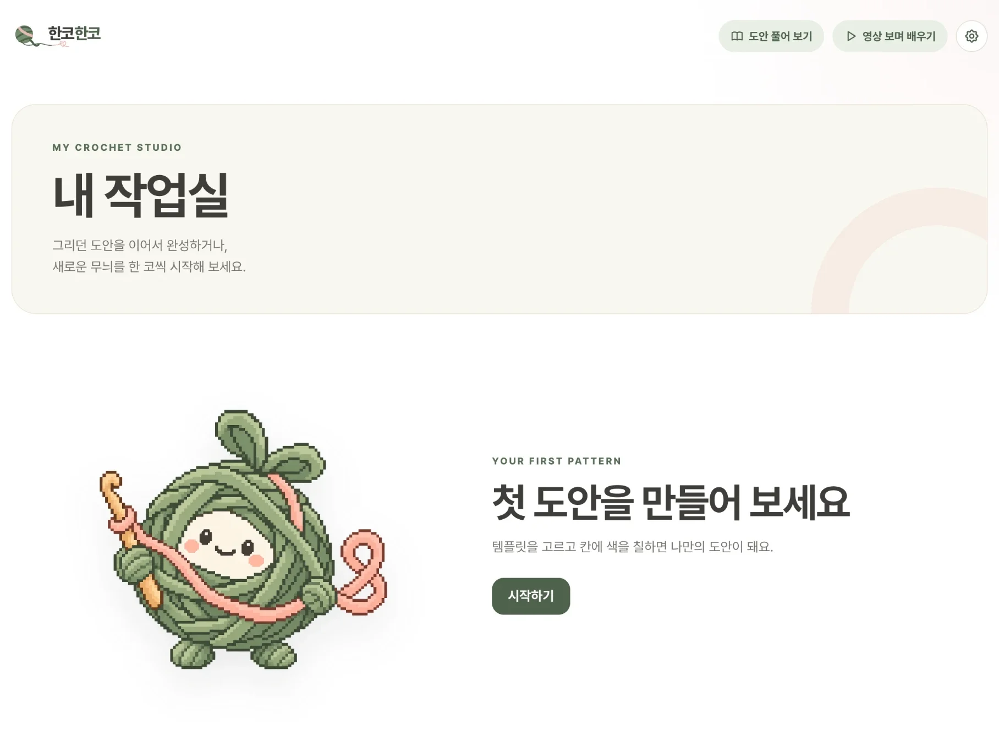
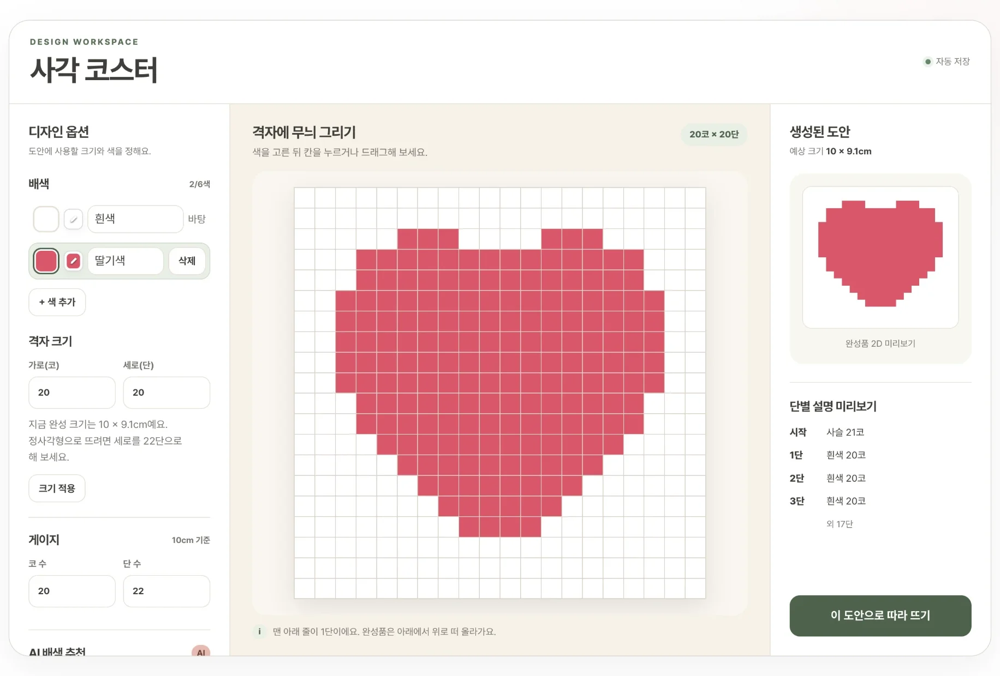
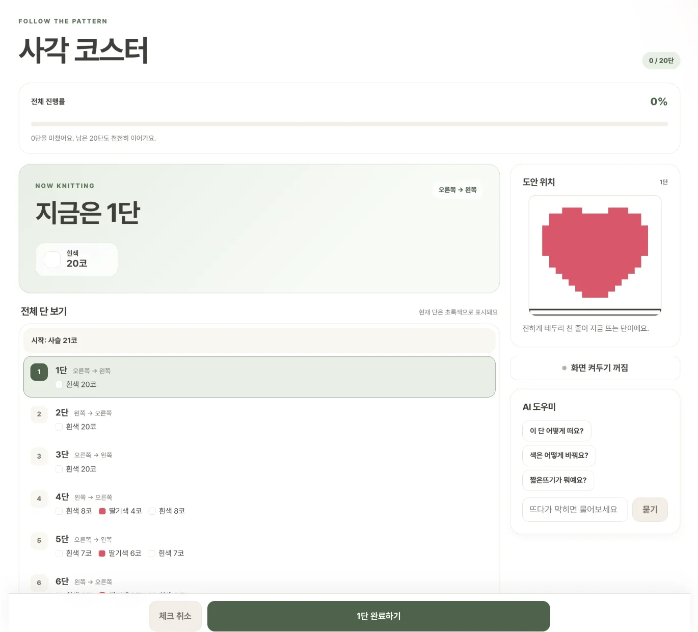
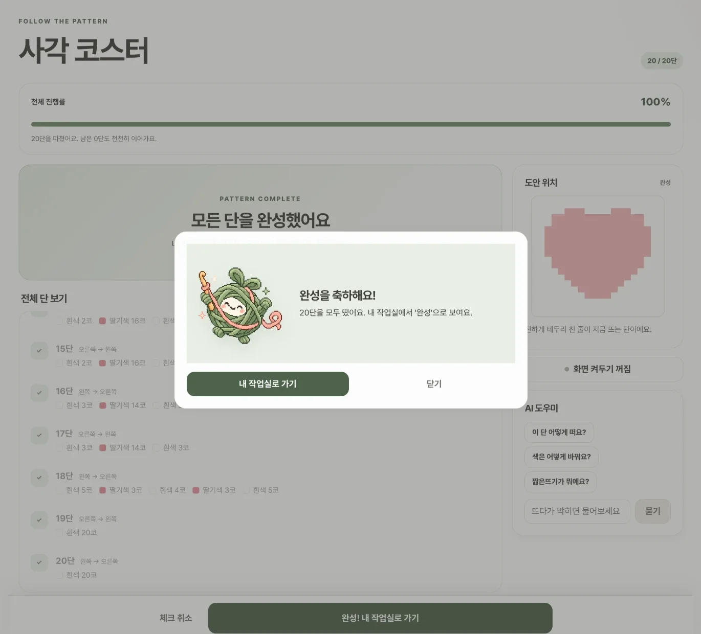
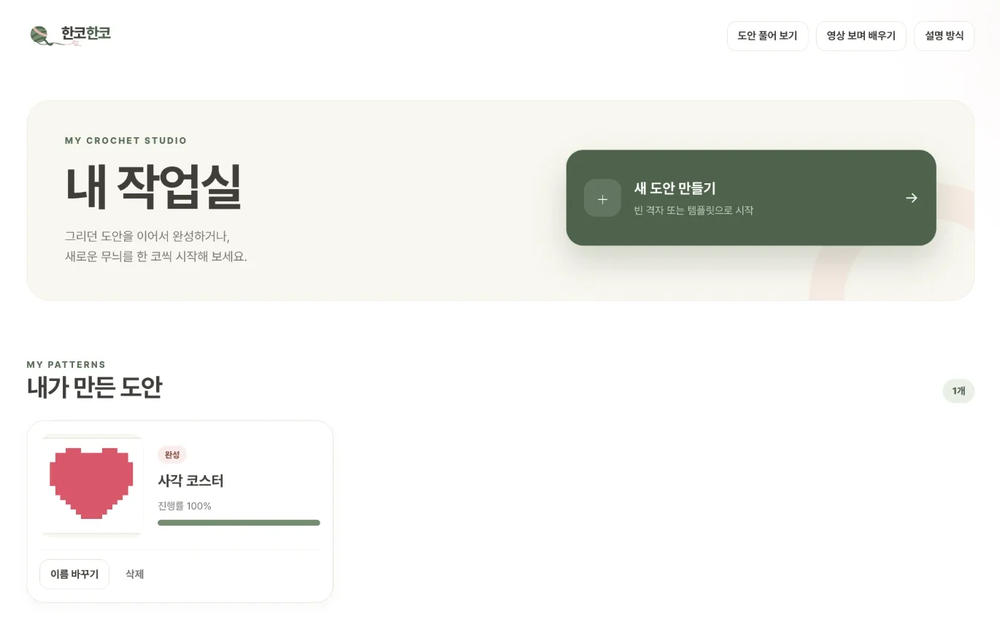
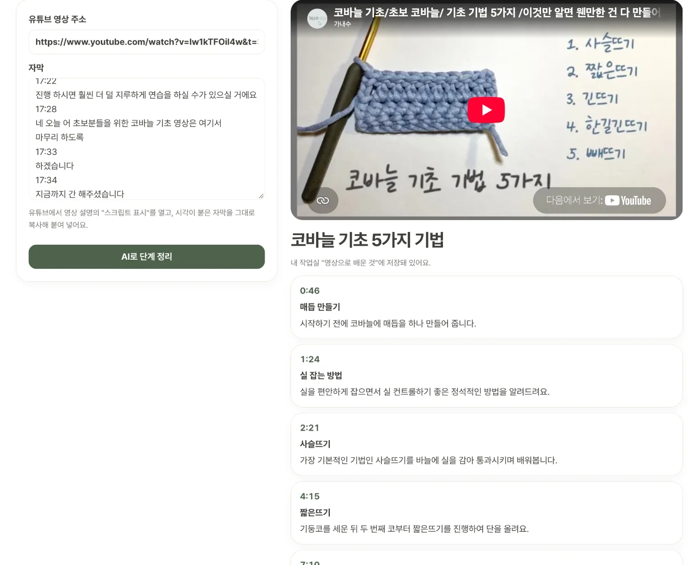
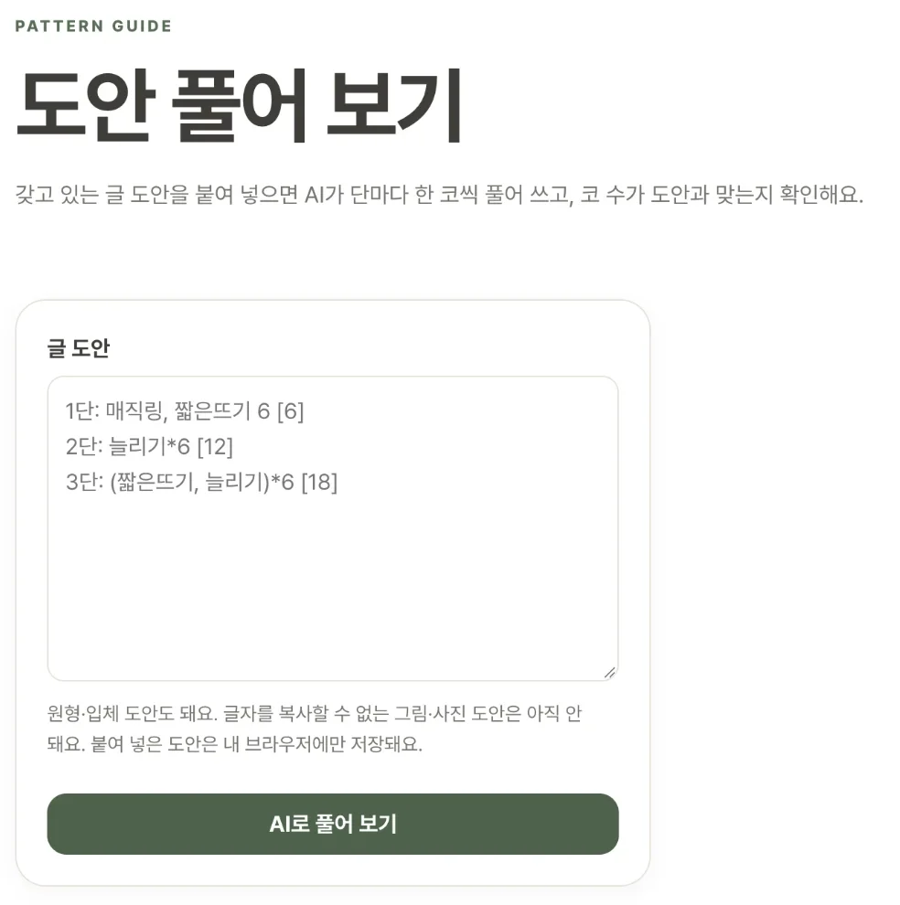

# 한코한코

> **격자에 색을 칠해 나만의 코바늘 도안을 만들면, 한 단씩 따라 뜰 수 있는 설명으로 바꿔 주고, 막히는 부분은 내가 고른 설명 방식대로 AI가 알려 주는 웹사이트**

- 사이트: https://hanko-red.vercel.app/



---

## 1. 제작한 것 소개

### 왜 만들었나요?

겨울이 되니 뜨개질을 해 보고 싶어졌다. 막상 시작하려니 나는 완전 초보였고, 남이 만든 도안을 그대로 따라 하기보다는 **내가 원하는 도안을 직접 만들어 보고 싶었다.** 또 다른 사람의 도안이나 영상을 보다가 막힐 때 **하나하나 자세히 알려 주는 곳**이 있으면 좋겠다고 생각했다. 그래서 이 두 가지를 한곳에서 할 수 있는 웹을 만들었다.

유튜브를 보고 코스터를 한두 개 떠 보면, 그다음에는 "내가 원하는 무늬"를 뜨고 싶어진다. 그런데 그런 도안은 찾기 어렵고, 모눈종이에 직접 그려도 그 그림을 "몇 단에 무슨 색 몇 코"로 바꾸는 일은 초보에게 너무 어렵다. 겨우 뜨기 시작해도 지금 몇 단째인지 헷갈리고, 모르는 용어가 나오면 다시 검색해야 한다.

한코한코는 **디자인 → 단별 설명 → 따라 뜨기 → 질문하기**를 한 사이트에서 잇는다. 만든 도안은 로그인 없이 브라우저에 저장되고, 화면에는 영어 약어(sc, ch) 없이 한국어 뜨개 용어만 쓴다.

### 이렇게 써요

1. **설명 방식 고르기**: 처음 들어오면 "차근차근" 또는 "핵심만"을 고른다. AI 도우미의 설명 깊이가 이 선택에 맞춰진다.
2. **새 도안 만들기**: 빈 격자 또는 무늬 템플릿(하트 사각 코스터 20×20칸, 산 태피스트리 벽걸이 30×40칸)에서 시작한다.
3. **격자에 칠하기**: 색을 고르고 칸을 누르거나 드래그해서 칠한다. 완성품 미리보기와 완성 크기(cm)가 바로 바뀐다.

   

   *색을 칠하면 오른쪽에 완성품 미리보기와 한 단씩 따라 뜰 단별 설명이 바로 바뀐다.*
4. **따라 뜨기**: "시작: 사슬 21코"와 단별 설명을 보며 한 단을 뜰 때마다 "N단 완료하기"를 누른다. 막히면 AI 도우미에게 묻는다.

    

   *지금 뜰 단이 강조되고, 막히면 옆의 AI 도우미에게 묻는다. 마지막 단까지 완료하면 축하 팝업이 뜬다.*
5. **내 작업실**: 만든 도안이 상태(디자인 중 / 뜨는 중 / 완성), 진행률과 함께 모여 있다. 다음 날 들어와도 멈춘 단부터 이어서 뜬다.

   

   *만든 도안이 상태와 진행률과 함께 모여 있고, 누르면 멈춘 단부터 이어서 뜬다.*
6. **영상 보며 배우기**(선택 기능): 유튜브 뜨개 영상의 주소와 자막을 붙여 넣으면 AI가 단계별로 정리하고, 단계를 누르면 그 장면부터 재생된다.

   

7. **도안 풀어 보기**(선택 기능): 갖고 있는 남의 글 도안을 붙여 넣으면 AI가 부분·단별로 한 코씩 풀어 쓰고, 코 수가 도안에 적힌 숫자와 맞는지 확인해 준다. 원형·입체 도안도 되고, 단을 체크하며 뜰 수 있다. 막히는 단은 그 단의 "이 단 물어보기"로 바로 물어본다.

   

### 핵심 기능

| 기능 | 내용 |
|---|---|
| 설명 방식 선택 | 첫 접속 때 고르고, 내 작업실 오른쪽 위 톱니바퀴(설명 방식)에서 언제든 바꾼다. |
| 격자 편집기 | 클릭·드래그로 칠하고, 휴대폰에서는 손가락으로도 칠할 수 있다. 배색은 최대 6색이고, 3색을 넘으면 "초보에게는 2\~3색을 추천해요" 안내가 뜬다. 격자 크기는 5\~60칸이며, 줄이면 왼쪽 아래(1단 시작점)를 기준으로 남긴다. 게이지(10cm당 코·단 수)를 넣으면 완성 크기를 계산하고, 정사각형이 아니면 "정사각형으로 뜨려면 세로를 22단으로 해 보세요"처럼 단 수를 알려 준다. |
| AI 배색 추천 | "봄 느낌으로"처럼 분위기를 쓰면 지금과 같은 색 수로 배색 3안이 나온다. 하나를 누르면 무늬는 그대로 두고 색만 바뀐다. |
| 단별 설명 | 맨 아래 줄이 1단이다. 홀수 단은 오른쪽 → 왼쪽, 짝수 단은 왼쪽 → 오른쪽으로 읽고(오른손잡이 왕복뜨기), 같은 색이 이어지면 "연노랑 8코 → 올리브 4코 → 연노랑 8코"처럼 묶는다. |
| 따라 뜨기 | 지금 단을 목록과 작은 격자 양쪽에서 강조한다. 화면 아래 고정된 큰 버튼으로 한 단씩 체크하고, 체크를 취소할 수도 있다. 지원하는 브라우저에서는 뜨는 동안 화면이 꺼지지 않게 "화면 켜두기"를 켤 수 있다. |
| AI 도우미 | 질문할 때 지금 단의 방향·색·코 수와 설명 방식을 함께 보낸다. 자주 묻는 질문 3개("이 단 어떻게 떠요?", "색은 어떻게 바꿔요?", "짧은뜨기가 뭐예요?")는 버튼으로 바로 묻는다. 대화는 도안마다 최근 20개까지 저장돼 나갔다 와도 남고, "대화 지우기"로 지울 수 있다. |
| 내 작업실 | 도안마다 미리보기·상태·진행률을 보여 주고, 따라 뜨기·이어서 뜨기, 이름 바꾸기, 삭제(확인창을 띄움)를 할 수 있다. 새로고침해도 보던 편집기·따라 뜨기 화면이 그대로 열린다. |
| 영상 보며 배우기 (선택) | 유튜브 영상 주소와 시각이 붙은 자막을 붙여 넣으면 AI가 단계와 시각을 정리하고(자막의 sc 같은 약어는 한국어 용어로), 단계를 누르면 그 시각부터 재생한다. 처음 들어오면 자막도 넣어야 한다는 안내 팝업이 뜨고, 정리한 결과는 내 작업실 "영상으로 배운 것"에 저장돼 다시 열거나 지울 수 있다. 공식 기능으로는 남의 영상 자막을 가져올 수 없어서 자막은 직접 붙여 넣는 축소판이다. |
| 도안 풀어 보기 (선택) | 글 도안을 붙여 넣으면 "꽃", "이파리"처럼 부분으로 나누고, 단마다 `(짧은뜨기, 늘리기)*6 [18]` 같은 줄임 표기를 "다음 코에 짧은뜨기 1번 → 다음 코에 늘리기 → 6번 반복"처럼 풀어 쓴다. 도안에 적힌 `[18]`·`(16코)`와 AI가 직접 센 코 수가 같으면 "✓ 도안과 같아요", 다르면 "⚠"로 알린다(AI가 베끼지 못하게 적힌 숫자는 지우고 보냄). 나온 용어(매직링, 늘리기 등)는 눌러서 뜻을 본다. 단마다 "이 단 물어보기"를 누르면 그 단의 원문과 풀이를 아는 AI에게 바로 묻는다(답은 저장하지 않음). `5-8단`처럼 여러 단을 한 줄로 쓴 건 5·6·7·8단을 하나씩 체크한다. 단을 체크하면 내 작업실 "풀어 본 도안"에 진행률과 함께 저장되고, 도안에 제목이 없으면 "붙여 넣은 도안"으로 저장돼 풀이 화면이나 내 작업실의 "이름 바꾸기"로 이름을 정한다. 격자로 바꾸거나 미리보기를 그리지는 않고, 글자를 복사할 수 없는 그림·사진 도안은 아직 안 된다. |

### 비슷한 서비스와 다른 점

> **내가 만든 도안이든 남의 글 도안이든, 지금 뜨는 단에서 막히면 그 자리에서 내 설명 방식에 맞게 물어볼 수 있다.**

| | Stitch Fiddle | knitCompanion | 유튜브 튜토리얼 | 한코한코 |
|---|---|---|---|---|
| 내 무늬 직접 디자인 | O | X (도안을 따로 구해 옴) | X (정해진 작품만) | O |
| 단별 설명 | 영어 형식, 색 이름을 직접 입력 | 불러온 도안 PDF를 그대로 봄 | 영상 속 설명 | **입력 없이 한국어로 바로** |
| 뜨다가 막히면 | 물어볼 곳 없음 | FAQ·Ravelry 그룹 | 댓글 | **지금 단을 아는 AI가 고른 설명 방식대로 바로 답함** |
| 남의 글 도안 읽기 | 없음 | 도안 PDF를 불러와 지금 단 표시 | 없음 | **줄임 표기를 한 코씩 풀고 코 수 확인** |
| 영상 따라 하기 | 없음 | 없음 | 영상만 있음 | **자막을 단계로 정리, 누르면 그 장면부터 재생** |
| 비용 | 무료(차트 15개) + 유료 | 기본 무료 + 연 구독 | 무료 | 무료, 로그인 없음 |

"격자 → 단별 글 도안 → 현재 단 표시하며 따라 뜨기" 흐름 자체는 Stitch Fiddle에 이미 있다. 그래서 한코한코는 같은 기능을 더 많이 만드는 대신, 직접 디자인은 코스터·벽걸이 템플릿과 짧은뜨기 하나로 범위를 좁히고 **뜨는 도중에 묻고 답을 듣는 부분**에 집중했다. 표의 다른 서비스 내용은 2026-11-01에 각 서비스 공식 페이지에서 확인한 것이고 직접 가입해서 써 보지는 않았다. 출처와 자세한 비교는 [PRD 2-1](PRD.md#2-1-비슷한-서비스와-차이점)에 있다.

### 만든 방식

| 부분 | 쓴 것 |
|---|---|
| 화면 | React 19 + Vite. 화면 이동은 라우터 없이 `App.jsx`의 `page` 상태로 처리 |
| 저장 | 브라우저 `localStorage`. 저장값이 망가져 있으면 그 도안만 빼고 읽어서 앱이 멈추지 않음 |
| AI | Vercel 서버리스 함수 `/api/ai` → Google Gemini API 무료 버전(`gemini-3.5-flash-lite`) |
| 테스트 | Node 내장 `node --test`로 38개(완성 크기, 크기 바꾸기, 단별 설명, 저장, AI 요청 검사, 영상 자막·시각 검사, 도안 풀이·코 수 읽기) |
| 배포 | Vercel |

저장소가 Public이고 누구나 사이트에서 AI를 부를 수 있어서, AI 부분에는 안전장치를 두었다.

- API 키는 Vercel 환경 변수에만 있고, 코드와 커밋 어디에도 없다(모든 커밋을 검색해 확인, Todo 6-11).
- 화면은 정해진 값(수준, 질문, 도안 크기, 지금 단)만 보내고, AI에게 주는 지시문은 서버가 만든다.
- 질문 200자, 분위기 40자, 답 600자로 길이를 제한한다.
- 배색 답이 JSON 형식에 맞지 않으면 한 번 더 요청한다.
- AI 호출이 실패하면 "지금은 AI가 바빠요. 잠시 후 다시 시도해 주세요." 안내가 뜨고, 편집 중인 도안과 진행 기록은 그대로 남는다.

### 주요 파일

| 파일 | 하는 일 |
|---|---|
| [`src/config.js`](src/config.js) | 템플릿 크기, 게이지 기본값, 최대 색 수, 격자 범위, AI 지시문을 한곳에 모음 |
| [`src/lib/pattern.js`](src/lib/pattern.js) | 단별 설명 변환, 완성 크기, 크기 바꾸기, 색 지우기, 진행 상태 |
| [`src/lib/storage.js`](src/lib/storage.js) | 도안·수준·보던 화면·AI 대화·영상 정리·풀어 본 도안 저장과 망가진 값 걸러내기 |
| [`src/lib/ai.js`](src/lib/ai.js) | AI 요청 검사와 답 검사(서버와 화면이 같이 씀) |
| [`api/ai.js`](api/ai.js) | Gemini를 부르는 서버리스 함수 |
| [`src/pages/`](src/pages) | 화면 7개: 수준 선택, 내 작업실, 템플릿 고르기, 격자 편집기, 따라 뜨기, 영상 보며 배우기, 도안 풀어 보기 |

### 직접 실행하기

```bash
npm install
```

```bash
npm run dev
```

AI 기능까지 쓰려면 [Google AI Studio](https://aistudio.google.com)에서 무료 API 키를 받아 프로젝트 폴더의 `.env.local`에 `GEMINI_API_KEY=발급받은키`를 넣는다. `.env.local`은 `.gitignore`에 들어 있어 커밋되지 않는다. 테스트는 아래 명령으로 돌린다.

```bash
npm test
```

---

## 2. PRD와 Todo 리스트

| 문서 | 내용 |
|---|---|
| [PRD.md](PRD.md) | 무엇을, 누구를 위해, 어디까지 만들지 정리한 문서다. 목적, 비슷한 서비스, 사용자·페르소나, 핵심 기능 6개, 만들지 않는 것, 디자인, 화면에 쓰는 말, 기술 조건, 열린 질문과 결정, 완성 기준이 들어 있다. |
| [TODO.md](TODO.md) | PRD를 6단계 작업으로 나누고, 써 보며 찾은 불편을 고친 7단계와 선택 항목을 더한 목록이다. 항목마다 "단계-순번" 번호, 근거가 되는 PRD 번호, 우선순위(P1~P3)를 붙였다. 단계마다 확인 방법과 테스트 기록, 맨 아래에 변경 내역이 있다. |

### PRD 요약

- **목적**: 디자인 → 도안 읽기 → 진행 기록 → 질문하기가 한 곳에서 이어져, 초보도 자기만의 작품을 끝까지 완성하게 한다.
- **사용자**: 코바늘을 막 시작했거나 짧은뜨기 정도는 하는 사람. 디자인은 노트북에서, 뜰 때는 휴대폰을 옆에 세워 둔다. 양손이 바쁘고 영어 약어를 모른다.
- **핵심 기능 6개**: ① 수준(설명 방식) 선택 ② 템플릿 격자에 칠하기와 완성 크기 ③ AI 배색 추천 ④ 단별 설명으로 한 단씩 따라 뜨기와 이어 뜨기 ⑤ 지금 단을 아는 AI 도우미 ⑥ 내 작업실
- **만들지 않는 것**: 링크만으로 하는 영상 자동 해설, 사진 → 격자 변환, 도안 검색·공유, 원형·입체·대바늘·짧은뜨기 외 기법의 직접 디자인, 로그인·서버 DB, 내보내기·인쇄, 쇼핑 연결
- **완성 기준**: 수준 유지, 칠하면 미리보기·크기가 바로 바뀜, 배색 3안 적용, 모든 단의 코 수 합 = 가로 칸 수, 새로고침 후 멈춘 단부터, 단에 맞춘 AI 답, 375px에서 가로 스크롤 없음, 저장소에 API 키 없음 (11개, 6단계에서 모두 점검)

<details>
<summary>PRD.md 전문</summary>

````markdown
# 한코한코 PRD — 내가 디자인한 격자 도안으로 떠보는 코바늘 사이트

---

## 0. AI에게 보내는 요청 (그대로 두세요)

당신은 이 프로젝트를 함께 만드는 개발 담당자입니다. 아래 요구 사항 문서를 읽고,

1. 이해한 내용을 3~5줄로 요약해서 확인받으세요.
2. 문서에서 불명확하거나 결정이 필요한 부분이 있다면, 작업 시작 전에 저에게 질문하세요.
3. 확인이 끝나면 구현 계획(단계별 할 일 목록)을 먼저 제안하고, 제가 승인하면 작업을 시작하세요.
4. "만들지 않는 것" 항목에 있는 기능은 제가 따로 요청하기 전까지 절대 구현하지 마세요.

---

## 1. 프로젝트 개요

- 프로젝트 이름: 한코한코
- 한 줄 소개: 격자에 색을 칠해 나만의 코바늘 도안을 만들면, 한 단씩 따라 뜰 수 있는 설명으로 바꿔 주고, 막히는 부분은 내 수준에 맞춰 AI가 알려주는 웹사이트
- 만드는 사람: 나 (인프 중간고사 바이브 코딩 과제)
- 완성 목표일: 중간고사 제출일까지 (날짜 기입)

## 2. 왜 만드나요? (목적)

유튜브를 보고 코스터를 한두 개 떠 보면, 그다음엔 "내가 원하는 무늬"를 뜨고 싶어진다. 그런데 원하는 무늬의 도안은 찾기 어렵고, 모눈종이에 직접 그려도 그걸 "몇 단에 무슨 색 몇 코"로 바꾸는 건 초보에게 너무 어렵다. 겨우 뜨기 시작해도 지금 몇 단째인지 헷갈리고, 모르는 용어가 나오면 다시 검색해야 한다.

디자인, 도안 읽기, 진행 기록, 질문하기가 **한 곳에서 이어지면** 초보도 자기만의 작품을 끝까지 완성할 수 있다.

## 2-1. 비슷한 서비스와 차이점

| 서비스 | 하는 일 | 아쉬운 점 |
|---|---|---|
| Stitch Fiddle (온라인 차트 편집기) | 격자에 색을 칠해 뜨개·코바늘·십자수 등 차트를 만든다. 대바늘·코바늘·C2C 차트는 "Written instructions"로 **단마다 "Row 2: red, blue (2 sts)" 같은 글 도안**으로 바꿔 준다(십자수·자유형 코바늘은 제외). **Progress tracker**로 지금 단을 표시하며 휴대폰·태블릿에서 따라 뜰 수 있다. 무료(차트 15개, 300×300칸)와 유료(월 €2부터) | 기능이 많은 범용 편집기라 초보가 무엇부터 할지 알기 어렵다. 글 도안은 색·코 이름을 사용자가 직접 입력해야 하고 영어 약어 형식이다. 뜨다가 모르는 걸 물어볼 곳은 없다. 한국어 화면 지원 여부는 확인 못 함 |
| Ravelry | 도안·실 데이터베이스(약 50만 개 도안), 작품·실 보관함 기록, 포럼·그룹 | 남이 만든 도안을 찾고 기록하는 곳. 소개 페이지에 내 무늬를 디자인하는 도구는 없음 |
| knitCompanion (단수 카운터·따라 뜨기 앱) | 도안 PDF를 불러와 현재 단 마커·하이라이트, 카운터 여러 개, 반복 알림. iOS·Android·macOS 앱, 기본 무료 + 연 구독(US$30부터) | 도안은 따로 구해 와야 하고 직접 디자인은 못 함. 대바늘 중심이며 코바늘 지원은 소개 페이지에서 확인 못 함. 질문은 FAQ·Ravelry 그룹으로 |
| 유튜브 튜토리얼 | 손동작을 영상으로 보여줌 | 정해진 작품만 따라 할 수 있고, 내 무늬에 맞춘 설명은 없음 (따로 확인하지 않은 일반적인 정리) |

→ **겹치는 부분(솔직히):** "격자 → 단별 글 도안 → 현재 단 표시하며 따라 뜨기" 흐름 자체는 Stitch Fiddle에 이미 있다. 한코한코의 차이는 기능 자체가 아니라 **초보 눈높이**에 있다.
→ 한코한코는 코스터·벽걸이 템플릿과 짧은뜨기 하나로 범위를 좁혀, 이름 입력 없이 **"1단: 흰색 5코, 빨강 3코"처럼 한국어 단별 설명**을 바로 만들고, 큰 버튼으로 한 단씩 체크하며 뜨다가 **지금 단과 내 수준에 맞춰 AI에게 묻는 것**까지 한 사이트에서 잇는다. 이 마지막 AI 질문은 위 서비스 어디에도 없다.

> 확인: 2026-11-01, 각 서비스 공식 페이지 — Stitch Fiddle [Written instructions 도움말](https://www.stitchfiddle.com/en/help/1pen-80n7rh/geschreven-uitleg), [Progress tracker 도움말](https://www.stitchfiddle.com/en/help/1pdx-98nqe4/progress-tracker), [요금 페이지](https://www.stitchfiddle.com/en/premium) / [Ravelry 소개](https://www.ravelry.com/about) / [knitCompanion](https://knitcompanion.com/). 직접 가입해서 써 보지는 않았고 페이지 설명만 확인함. 확인 못 한 것: Stitch Fiddle 한국어 지원과 글 도안이 무료에서도 되는지, knitCompanion 코바늘 지원.

## 3. 누가 사용하나요? (사용자)

- 주 사용자: 코바늘을 막 시작했거나 짧은뜨기 정도는 할 줄 아는 사람
- 사용 환경: 디자인은 노트북에서, 뜰 때는 휴대폰을 옆에 세워 두고 봄
- 사용자에 대해 알아야 할 점:
  - 뜨는 동안 양손이 바빠서 화면을 자주 만질 수 없다. 버튼은 크고, 한 번 누르면 끝나야 한다.
  - 도안 기호와 약어(sc, ch 등)를 모른다. 화면에는 한국어 용어만 쓴다.
  - 진행 기록이 사라지면 몇 단째인지 다시 세야 해서 바로 포기하게 된다.

## 3-1. 대표 사용자 페르소나

- 이름/나이: 한유리 / 21세 대학생
- 상황: 유튜브를 보고 기본 코스터를 두 개 떠 봤다. 친구 생일 선물로 친구가 좋아하는 딸기 무늬 코스터를 직접 디자인해서 떠 주고 싶다.
- 바라는 것: 머릿속 무늬를 칸에 칠하기만 하면 "몇 단에 무슨 색 몇 코"가 나오고, 뜨다가 멈춰도 다음 날 이어서 뜰 수 있으면 좋겠다.
- 불편해하는 것: 영어 약어로 된 도안, 로그인, 몇 단째인지 헷갈리는 것, 실을 손에 쥔 채로 화면을 여러 번 눌러야 하는 것

## 4. 꼭 있어야 하는 기능 (핵심 기능)

1. 사용자는 처음 들어왔을 때 자기 수준(차근차근 / 핵심만)을 고르고, 나중에 설정에서 바꿀 수 있다.
2. 사용자는 템플릿(사각 코스터 20×20칸, 태피스트리 벽걸이 30×40칸)을 무늬가 있는 채로 또는 빈 격자로 골라 격자에 색을 칠하고, 팔레트와 격자 크기를 바꾸며, 완성품 미리보기와 완성 크기(cm)를 바로 볼 수 있다.
3. 사용자는 "봄 느낌으로" 같은 분위기를 입력해 AI에게 배색을 3가지 추천받고, 고른 배색을 무늬는 그대로 둔 채 적용할 수 있다.
4. 사용자는 칠한 격자를 "1단: 흰색 5코, 빨강 3코…" 같은 단별 설명으로 받아 한 단씩 따라 뜨고, 끝낸 단을 체크하며 진행률을 보고, 다시 들어와도 멈춘 단부터 이어서 뜰 수 있다.
5. 사용자는 따라 뜨는 중에 AI 도우미에게 질문하고, 지금 뜨는 단과 자기 수준에 맞춘 답을 받을 수 있다.
6. 사용자는 내 작업실에서 내가 만든 도안을 상태(디자인 중 / 뜨는 중 / 완성)와 진행률로 모아 보고, 이어서 하거나 삭제할 수 있다.

## 5. 만들지 않는 것 (범위 제외)

- 유튜브 영상 링크만으로 하는 자동 해설 (자막 기반 분석이 막히는 경우가 많고, 중심 기능인 직접 디자인과 연결이 약함). 사용자가 자막을 직접 붙여 넣는 축소판만 선택-1로 만듦
- 사진을 격자 도안으로 바꾸기
- 다른 사람 도안 검색·공유, 커뮤니티 (저작권 문제, 범위가 큼)
- 입체 작품(인형, 가방), 원형으로 뜨는 작품, 대바늘을 **직접 디자인하기**
- 짧은뜨기 외의 뜨개 기법을 **직접 디자인하기** (한길긴뜨기, C2C 등)
  - 위 두 줄은 격자 편집기에만 적용한다. 남의 글 도안을 붙여 넣어 풀어 보는 선택-2는 원형·다른 기법도 **설명하고 단 체크만** 한다(격자로 바꾸거나 미리보기를 그리지 않음).
- 회원가입/로그인, 서버 DB, 여러 기기 동기화
- 도안 PDF·이미지 내보내기, 인쇄
- 실 구매·쇼핑 연결

## 6. 모양과 분위기 (디자인)

- 원하는 느낌: `Cozy` · `Handmade` · `Warm Minimal` · `Calm` · `Beginner Friendly`. 흰 바탕에 따뜻한 색감, 장식은 최소화. 편집기는 깔끔하게, 따라 뜨기 화면은 큰 글씨와 큰 버튼. 과한 뜨개 무늬 배경·이모지 남발·번쩍이는 애니메이션은 쓰지 않음
- 주요 색상: 흰 바탕 `#FFFFFF`, 메인 세이지 그린 `#738D70`(주요 버튼·진행 상태), 피치 포인트 `#E8B9B0`(따뜻한 강조). 연한 색은 배경 위주로 쓰고 글자는 어두운 색(`#403E3A`)으로 대비 확보
- 글꼴: Pretendard (대체 Noto Sans KR)
- 참고: 작업 폴더의 DESIGN.md (저장소에는 올리지 않음)
- 처음 결정: 크림·베이지 바탕에 딸기우유 분홍 포인트 → 바꾼 결정: DESIGN.md의 세이지 그린 메인 + 피치 포인트
- 바꾼 결정 (6단계 후): 페이지 바탕 크림 `#FAF7F0` → 흰색 `#FFFFFF`. 흰 바탕이 더 깔끔해 보여서

## 6-1. 화면에 쓰는 말

개발 중에 용어가 바뀌면 PRD, TODO, 코드를 모두 고쳐야 하므로 처음에 정해 둔다.

| 쓰는 말 | 뜻 | 쓰지 않는 말 |
|---|---|---|
| 도안 | 사용자가 만든 작품 하나 | 패턴, 차트 |
| 칸 | 격자 한 칸 = 1코 | 셀, 픽셀 |
| 코 / 단 | 가로 한 칸 / 가로 한 줄 | sc, row |
| 배색 | 도안에 쓰는 색 묶음 | 팔레트(화면에서는) |
| 따라 뜨기 | 한 단씩 보며 뜨는 화면 | 진행 모드 |
| 내 작업실 | 내 도안 목록 | 마이페이지 |
| 디자인 중 / 뜨는 중 / 완성 | 도안 상태 | |
| 차근차근 / 핵심만 | 사용자 수준(AI 도우미의 설명 방식) | 완전 초보 / 기초는 앎(처음 이름, 6단계 후 바꿈) |

- 제목 위의 작은 장식 문구(`MY CROCHET STUDIO`, `START A NEW PATTERN`, `BLANK GRID` 등)는 영어를 써도 된다. 버튼, 안내 문장, 뜨개 용어처럼 사용자가 읽고 따라야 하는 글자는 위 표의 한국어만 쓴다. (디자인 개편 후 추가)

## 7. 기술 조건

- 결과물 형태: 웹사이트 (Vercel에 배포)
- 사용할 도구나 언어: React (Vite), Vercel 서버리스 함수 하나 (`/api/ai`), AI는 Google Gemini API 무료 버전(Flash-Lite 모델)
- 지켜야 할 조건:
  - 도안·수준·진행 기록은 브라우저 `localStorage`에 저장한다. 저장값이 망가져 있어도 앱이 멈추지 않고 빈 상태로 시작한다.
  - **AI API 키는 Vercel 환경 변수에만 둔다.** 저장소가 Public이므로 키를 코드나 커밋에 넣지 않고, `.env`는 `.gitignore`에 넣는다.
  - 누구나 사이트에서 AI를 부를 수 있으므로, 서버리스 함수에서 질문 길이(200자)와 답변 길이를 제한한다. Gemini 무료 버전은 결제가 없어 요금이 나오지 않고, 한도를 넘으면 429 오류가 나므로 "잠시 후 다시 시도해 주세요"로 처리한다.
  - AI 호출이 실패해도 편집 중인 도안과 진행 기록은 그대로 남고, 화면에는 "잠시 후 다시 시도해 주세요"가 뜬다.
  - 템플릿 크기, 게이지 기본값, 최대 색 수, 격자 크기 범위, AI에게 주는 지시문은 한 파일(`config.js`)에 모아서 쉽게 조절한다.
  - 따라 뜨기와 AI 도우미는 휴대폰 폭(375px)에서 가로 스크롤 없이 쓸 수 있어야 한다.
- 저장 형식 (도안 하나):

```js
{
  id, name, templateId,
  width, height,
  palette: [{ name: '흰색', hex: '#ffffff' }, ...],  // 최대 6색
  cells: [0, 0, 1, ...],    // 칸마다 배색 번호, 맨 위 줄부터 왼쪽→오른쪽, 길이 = width × height
  gauge: { stitches: 20, rows: 22 },                 // 10cm당 코 수·단 수
  doneRows: [1, 2, 3],      // 체크한 단 번호
  status: 'design' | 'knitting' | 'done',
  updatedAt
}
```

## 8. 가정한 것들

- 한 사람이 한 브라우저에서 쓴다고 가정
- 모든 도안은 **짧은뜨기 왕복뜨기**로 뜬다고 가정 (태피스트리 뜨기처럼 안 쓰는 실을 감싸며 색을 바꿈)
- 오른손잡이 기준으로 설명한다고 가정
- 격자 한 칸 = 짧은뜨기 1코 = 1단이라고 가정
- 한 도안에 색은 최대 6개까지, 초보에게는 2~3색이 적당하다고 가정
- 사용자는 사슬뜨기와 짧은뜨기를 유튜브 등에서 배울 수 있다고 가정 (기법 자체를 영상으로 가르치지는 않음)

## 9. 결정하거나 조사해야 할 것 (열린 질문)

- 격자의 어느 줄이 1단일까?
  → **결정:** 뜨개는 아래에서 위로 올라가므로 맨 아래 줄이 1단이다.
- 각 단은 어느 방향으로 읽을까?
  → **결정:** 앞면에서 볼 때 홀수 단은 오른쪽 → 왼쪽, 짝수 단은 왼쪽 → 오른쪽 (오른손잡이 왕복뜨기).
- 시작할 때 기초 사슬은 몇 코?
  → **결정:** 가로 칸 수 + 1코 (짧은뜨기 기둥코 1코 포함). 단별 설명 맨 앞에 "시작: 사슬 21코"처럼 넣는다.
- 짧은뜨기 코는 정사각형이 아닌데 미리보기는 어떻게 그릴까?
  → **결정:** 미리보기 칸의 가로세로 비율을 게이지로 맞춘다 (기본 20코 × 22단이면 칸이 살짝 납작함). 편집 격자는 정사각형 그대로.
- 격자 크기를 줄이면 이미 칠한 칸은?
  → **결정:** 왼쪽 아래(1단 시작점)를 기준으로 남기고, 오른쪽·위쪽이 잘린다. 칠한 칸이 잘리면 먼저 확인창을 띄운다.
- 배색에서 색을 지우면 그 색 칸은?
  → **결정:** 첫 번째 색(바탕색)으로 바뀐다. 바탕색은 지울 수 없다.
- 뜨는 중인 도안을 다시 편집하면 진행 기록은?
  → **결정:** 무늬나 크기를 바꾸면 체크한 단이 맞지 않게 되므로, "진행 기록이 초기화돼요" 확인창 후 초기화한다. 배색만 바꾸는 건 진행 기록을 유지한다.
- AI 배색 추천은 어떤 형식으로 받을까?
  → **결정:** 현재 도안의 색 수만큼, 색 이름(한국어)과 색값을 JSON으로 3안 받는다. 형식이 틀리면 한 번 다시 요청하고, 또 틀리면 오류 메시지.
- AI 도우미 대화는 저장할까?
  → **결정:** 도안마다 브라우저에 최근 20개를 저장해 나갔다 와도 남게 한다. "대화 지우기" 버튼을 두고, 도안을 삭제하면 대화도 지운다.
- 뜨는 동안 휴대폰 화면이 꺼지는 문제는?
  → **결정:** 따라 뜨기 화면에서 "화면 켜두기"를 켤 수 있게 한다 (브라우저 Wake Lock 기능, 지원하지 않는 브라우저에서는 버튼을 숨김). 우선순위 낮음.
- AI 제공사는 어디로 할까?
  → **처음 결정 (5단계 전):** Claude Opus 5.5. 답변 품질이 좋고 JSON 구조화 출력 지원.
  → **바꾼 결정 (5단계 전):** Google Gemini API 무료 버전, **Flash-Lite 모델**(가장 가볍고 무료 하루 한도가 넉넉함. 짧은 배색 추천·도우미 답변에는 큰 모델이 필요 없음. 모델 이름 `gemini-3.5-flash-lite`, 무료 한도 분당 15회·분당 입력 25만 토큰을 AI Studio에서 확인). 이유: 과제라 비용 없이 쓰고 싶음, Claude API는 무료 사용량이 없음. Gemini도 JSON 형식 응답을 지원하고, 서버리스 함수 한 곳만 바꾸면 되도록 만든다.
- 처음부터 내 무늬를 그리고 싶으면?
  → **처음 결정:** 템플릿은 무늬가 칠해진 2종뿐.
  → **바꾼 결정 (6단계 후):** 같은 크기에 배색은 흰 바탕색 하나만 있는 "빈 사각 코스터", "빈 태피스트리 벽걸이"를 템플릿 고르기에 "빈 격자로 시작" 묶음으로 따로 추가(무늬 템플릿과 나눠 보여 줌). 칠할 색은 사용자가 "색 추가"로 직접 넣는다. 써 보니 처음부터 그리려면 하트·산을 일일이 지워야 해서 불편했음.

## 10. 완성 기준 (이러면 성공!)

- 처음 접속하면 수준 선택이 나오고, 고른 수준은 새로고침해도 유지된다.
- 사각 코스터 템플릿을 고르면 20×20 격자가 기본 무늬로 열린다.
- 칸을 클릭하거나 드래그하면 칠해지고, 미리보기와 완성 크기(cm)가 바로 바뀐다.
- 격자 크기를 바꾸면 완성 크기가 다시 계산된다. (20칸, 게이지 20코 → 가로 10cm)
- "봄 느낌으로"를 입력하면 배색 3안이 나오고, 하나를 누르면 무늬는 그대로인 채 색만 바뀐다.
- 단별 설명의 모든 단에서 코 수 합계가 가로 칸 수와 같고, 맨 아래 줄이 1단이며 홀수 단은 오른쪽부터 읽는다.
- 따라 뜨기에서 3단까지 체크하고 새로고침하면 4단부터 이어지고, 진행률이 15%(20단 중 3단)로 보인다.
- "이 단 어떻게 떠요?"를 누르면 지금 단의 색과 코 수를 언급하는 답이 오고, 차근차근과 핵심만에서 설명 깊이가 다르다.
- 도안 두 개를 만들면 내 작업실에서 각각의 상태와 진행률이 따로 보이고, 삭제할 때 확인창이 뜬다.
- 휴대폰 폭(375px)에서 따라 뜨기 화면에 가로 스크롤이 없다.
- 저장소 전체에서 API 키가 검색되지 않는다.
````

</details>

<details>
<summary>TODO.md 전문 (할 일, 테스트 기록, 변경 내역)</summary>

````markdown
# Todo 리스트 — 한코한코

## 사용 방법

- 1단계부터 순서대로 진행하고, 한 단계가 끝날 때마다 브라우저(휴대폰 폭 포함)에서 직접 확인한 뒤 다음 단계로 넘어간다.
- 모든 할 일에는 "단계-순번" 번호가 있다. AI와 대화할 때 "2-4가 안 돼"처럼 번호로 지목한다.
- 할 일 옆의 `(PRD #4-2)`는 그 작업이 필요한 PRD 항목이다.
- AI는 단계를 시작하기 전에 계획을 먼저 보여주고, **TODO 순서와 다르게 작업하려면 먼저 물어본다.**
- 완료한 항목은 `[ ]`를 `[x]`로 바꾸고, 커밋 + push 한다.
- 커밋 메시지는 `타입: 내용 (todo 번호)` 형식으로 쓴다. 예: `feat: 격자 칸 색칠 (todo 2-3~2-5)`
  - `feat` 기능 추가 · `fix` 버그 수정 · `docs` 문서(PRD, TODO, README) · `style` 디자인·CSS · `refactor` 동작은 그대로 코드 정리 · `test` 테스트 · `chore` 설정·패키지
- 할 일을 고치거나, 빼거나, 더하면 맨 아래 **변경 내역**에 날짜와 이유를 남긴다. (README 필수 항목)

## 우선순위

- `P1` (필수) 이것 없이는 앱이 동작하지 않는다.
- `P2` (중요) 있어야 PRD의 기능이 제대로 완성된다.
- `P3` (있으면 좋음) 시간이 부족하면 가장 먼저 뺀다. 뺀 항목은 README의 "개선에 필요한 점"에 적는다.

---

## 1단계: 프로젝트 준비와 화면 틀

목표: 배포된 주소로 들어가면 홈(내 작업실), 편집기, 따라 뜨기 화면 틀을 오갈 수 있다.

- [x] 1-1. Vite + React 프로젝트 만들기, `.gitignore`에 `.env` 넣기 (PRD #7) `P1`
- [x] 1-2. GitHub Public 저장소 만들고 PRD.md, TODO.md와 함께 첫 push (PRD #7) `P1`
- [x] 1-3. Vercel에 연결해서 배포 주소로 열리는지 확인 (PRD #7) `P1`
- [x] 1-4. `config.js` 만들기: 템플릿 크기, 게이지 기본값(20코 × 22단), 최대 색 수(6), 격자 범위(5~60칸) (PRD #7) `P1`
- [x] 1-5. 화면 3개 틀과 이동: 내 작업실(홈) → 편집기 → 따라 뜨기, 뒤로 가기 (PRD #4-2, #4-4, #4-6) `P1`
- [x] 1-6. DESIGN.md 기준 공통 스타일: 크림 바탕 + 세이지 그린 메인, Pretendard, 버튼·카드 (PRD #6) `P2`
- [x] 1-7. 화면 글자를 PRD 6-1의 "쓰는 말"로 통일 (PRD #6-1) `P2`

확인 방법: 배포 주소로 들어가면 홈이 보이고, 버튼으로 편집기·따라 뜨기 화면을 오갈 수 있다. 휴대폰 폭에서도 화면이 깨지지 않는다.

## 2단계: 템플릿과 격자 편집기

목표: 템플릿을 고르면 격자 편집기가 열리고, 칸을 칠하면 미리보기와 완성 크기가 바로 바뀐다.

- [x] 2-1. 템플릿 데이터 2종: 사각 코스터 20×20(하트 무늬, 2색), 태피스트리 벽걸이 30×40(산 무늬, 3색) (PRD #4-2) `P1`
- [x] 2-2. 템플릿 고르기 화면: 템플릿 그림, 크기, 색 수 표시. 고르면 복사본으로 새 도안 생성 (PRD #4-2) `P1`
- [x] 2-3. 격자 그리기: `cells` 배열을 칸으로 표시 (PRD #4-2, #7) `P1`
- [x] 2-4. 배색에서 색을 고르고 칸을 클릭하면 칠하기 (PRD #4-2) `P1`
- [x] 2-5. 마우스 드래그·손가락으로 여러 칸 이어 칠하기 (PRD #4-2) `P2`
- [x] 2-6. 배색 편집: 색 추가(최대 6색, 3색 넘으면 "초보에게는 2~3색을 추천해요" 안내), 색값·이름 변경 (PRD #4-2, #8) `P1`
- [x] 2-7. 색 삭제: 그 색 칸은 바탕색으로, 바탕색은 삭제 불가 (PRD #9) `P2`
- [x] 2-8. 격자 크기 조절(5~60칸): 왼쪽 아래 기준으로 남기고, 칠한 칸이 잘리면 확인창 (PRD #4-2, #9) `P2`
- [x] 2-9. 완성품 미리보기: 격자선 없이, 칸 비율은 게이지에 맞춰 살짝 납작하게 (PRD #4-2, #9) `P2`
- [x] 2-10. 게이지 입력(10cm당 코 수·단 수) → 완성 크기(cm) 표시 (PRD #4-2) `P1`
- [x] 2-11. 테스트: 완성 크기 계산을 터미널에서 돌리는 테스트 (20칸·20코 → 10cm, 40단·22단 → 18.2cm) `P2`
- [x] 2-12. 빈 격자 템플릿: "빈 사각 코스터", "빈 태피스트리 벽걸이" (같은 크기, 배색은 흰 바탕색 하나만, 템플릿 화면에서 "빈 격자로 시작" / "무늬 템플릿"으로 나눔) (PRD #4-2, #9) `P2` — 6단계 후 추가

확인 방법: 사각 코스터를 고르면 하트 무늬 20×20 격자가 열린다. 칸을 칠하면 미리보기가 바로 바뀐다. 가로를 30칸으로 늘리면 완성 가로가 15cm가 된다. 색을 지우면 그 칸들이 바탕색이 된다.

## 3단계: 저장, 내 작업실, 수준 선택

목표: 만든 도안이 저장되어 내 작업실에 모이고, 처음 접속하면 수준을 고른다.

- [x] 3-1. 도안을 바꿀 때마다 `localStorage`에 자동 저장 (PRD #4-6, #7) `P1`
- [x] 3-2. 저장값이 망가져 있으면 빈 상태로 시작 (PRD #7) `P1`
- [x] 3-3. 내 작업실: 도안 목록(작은 미리보기, 이름, 상태, 진행률), 도안이 없으면 "첫 도안을 만들어 보세요" 안내 (PRD #4-6) `P1`
- [x] 3-4. 도안 이름 바꾸기 (PRD #4-6) `P2`
- [x] 3-5. 도안 삭제: 확인창 후 삭제 (PRD #4-6, #10) `P2`
- [x] 3-6. 첫 접속 시 수준 선택 화면(완전 초보 / 기초는 앎), 선택 저장 (PRD #4-1) `P1`
- [x] 3-7. 설정에서 수준 바꾸기 (PRD #4-1) `P2`
- [x] 3-8. 테스트: 새로고침 후 도안·수준 유지, 저장값을 망가뜨리고 새로고침 → 에러 없이 빈 상태 `P2`

확인 방법: 도안 두 개를 만들고 새로고침해도 내 작업실에 둘 다 있다. 하나를 지우면 확인창 뒤에 사라진다. 저장 기록을 지우고 들어가면 수준 선택부터 나온다.

## 4단계: 단별 설명과 따라 뜨기

목표: 격자가 단별 설명으로 바뀌고, 한 단씩 체크하며 뜨다가 다시 들어와도 이어서 뜰 수 있다.

- [x] 4-1. 단별 설명 변환 함수: 맨 아래 줄이 1단, 홀수 단은 오른쪽 → 왼쪽, 짝수 단은 왼쪽 → 오른쪽, 같은 색 이어지면 묶기 (PRD #4-4, #9) `P1`
- [x] 4-2. 맨 앞에 시작 안내 넣기: "시작: 사슬 (가로 칸 수 + 1)코" (PRD #9) `P1`
- [x] 4-3. 테스트: 변환 함수를 터미널에서 돌리는 테스트 (모든 단의 코 수 합계 = 가로 칸 수, 2×2 격자로 방향 확인, 한 색만 있는 단) `P1`
- [x] 4-4. 따라 뜨기 화면: 단별 설명 목록 + 작은 격자, 현재 단을 양쪽에서 강조 (PRD #4-4) `P1`
- [x] 4-5. 큰 "이 단 끝!" 버튼으로 체크하고 다음 단으로 이동, 체크 취소 가능 (PRD #3, #4-4) `P1`
- [x] 4-6. 진행률 표시 (완료한 단 ÷ 전체 단) (PRD #4-4) `P1`
- [x] 4-7. 체크할 때마다 자동 저장, 다시 들어오면 첫 번째 안 끝낸 단부터 (PRD #4-4) `P1`
- [x] 4-8. 상태 자동 변경: 첫 체크 → "뜨는 중", 마지막 단 체크 → "완성" + 축하 메시지 (PRD #4-6) `P2`
- [x] 4-9. 뜨는 중인 도안의 무늬·크기를 바꾸면 "진행 기록이 초기화돼요" 확인창, 배색만 바꾸면 유지 (PRD #9) `P2`
- [x] 4-10. "화면 켜두기" 토글 (Wake Lock, 지원 안 하면 숨김) (PRD #9) `P3`

확인 방법: 하트 코스터에서 단별 설명을 열면 "시작: 사슬 21코"와 1~20단이 나온다. 3단까지 체크하고 새로고침하면 4단이 강조되고 진행률이 15%다. 휴대폰 폭에서 버튼을 한 손가락으로 누르기 쉽다.

## 5단계: AI 기능

목표: AI에게 배색을 추천받아 적용하고, 따라 뜨는 중에 수준에 맞는 답을 받는다.

- [x] 5-1. Google AI Studio에서 Gemini API 키 발급(무료), Vercel 환경 변수 `GEMINI_API_KEY`에 등록, AI Studio에서 쓸 모델의 무료 한도 확인 (PRD #7, #9) `P1` — 모델 `gemini-3.5-flash-lite`, 무료 한도 분당 15회·분당 입력 25만 토큰
- [x] 5-2. 서버리스 함수 `/api/ai`: 키는 Vercel 환경 변수에서 읽기, 질문 200자·답변 길이 제한 (PRD #7) `P1`
- [x] 5-3. AI 실패 시 "잠시 후 다시 시도해 주세요", 도안은 그대로 유지 (PRD #7) `P1`
- [x] 5-4. 배색 추천 입력창: 분위기 입력 → 현재 색 수만큼 3안 요청 (PRD #4-3) `P1`
- [x] 5-5. AI 답을 JSON(색 이름 + 색값)으로 받고, 형식이 틀리면 한 번 다시 요청 (PRD #9) `P1`
- [x] 5-6. 3안을 색 띠로 보여주고, 누르면 무늬는 그대로 색만 바꾸기 (PRD #4-3) `P1`
- [x] 5-7. AI 도우미 채팅창: 따라 뜨기 화면 옆(휴대폰은 아래) (PRD #4-5) `P1`
- [x] 5-8. 질문과 함께 수준, 도안 정보, 현재 단 설명을 AI에게 보내기 (PRD #4-5) `P1`
- [x] 5-9. 수준별 지시문을 `config.js`에: 완전 초보는 쉬운 말·순서대로, 기초는 앎은 짧게 (PRD #4-1, #4-5, #7) `P1`
- [x] 5-10. 자주 묻는 질문 버튼: "이 단 어떻게 떠요?", "색은 어떻게 바꿔요?", "짧은뜨기가 뭐예요?" (PRD #4-5) `P2`

확인 방법: "봄 느낌으로"를 입력하면 배색 3안이 나오고, 누르면 하트 모양은 그대로 색만 바뀐다. 4단에서 "이 단 어떻게 떠요?"를 누르면 4단의 색과 코 수를 언급한다. 수준을 바꿔 같은 질문을 하면 설명 깊이가 다르다. 인터넷을 끄고 질문하면 오류 메시지가 뜨고 도안은 그대로다.

## 6단계: 완성 기준 점검

목표: PRD 10번의 완성 기준을 전부 통과하고, 실제로 하루 써 본다.

- [x] 6-1. 처음 접속하면 수준 선택이 나오고, 새로고침해도 유지되는가?
- [x] 6-2. 사각 코스터를 고르면 20×20 격자가 기본 무늬로 열리는가?
- [x] 6-3. 칸을 클릭·드래그하면 칠해지고, 미리보기와 완성 크기가 바로 바뀌는가?
- [x] 6-4. 격자 크기를 바꾸면 완성 크기가 다시 계산되는가? (20칸, 20코 → 10cm)
- [x] 6-5. "봄 느낌으로" 배색 3안이 나오고, 누르면 무늬는 그대로 색만 바뀌는가?
- [x] 6-6. 모든 단의 코 수 합계가 가로 칸 수와 같고, 맨 아래 줄이 1단이며 홀수 단은 오른쪽부터 읽는가?
- [x] 6-7. 3단까지 체크하고 새로고침하면 4단부터 이어지고 진행률이 15%인가?
- [x] 6-8. "이 단 어떻게 떠요?"에 현재 단을 반영한 답이 오고, 수준별로 깊이가 다른가?
- [x] 6-9. 도안 두 개의 상태·진행률이 따로 보이고, 삭제할 때 확인창이 뜨는가?
- [x] 6-10. 휴대폰 폭(375px)에서 따라 뜨기 화면에 가로 스크롤이 없는가?
- [x] 6-11. 저장소 전체에서 API 키가 검색되지 않는가?
- [x] 6-12. 2단계·3단계·4단계 테스트가 모두 통과하는가?
- [x] 6-13. 직접 코스터 하나를 디자인하고 노트북(또는 휴대폰)으로 실제로 몇 단 떠 보며 불편한 점 기록

## 7단계: 써 보니 불편한 점 고치기

목표: 6단계 점검에서 직접 써 보며 찾은 불편(테스트 기록 6단계)을 고친다.

- [x] 7-1. 내 작업실에서 "디자인 중" 도안도 바로 "따라 뜨기" (PRD #4-6) `P1`
- [x] 7-2. 편집기·따라 뜨기 화면에서 새로고침해도 보던 도안 화면 유지, 도안이 없으면 내 작업실 (PRD #4-4) `P1`
- [x] 7-3. AI 배색 지시문: 실 색처럼 채도를 낮추고, 바탕색과 무늬 색의 밝기 차이를 크게 (PRD #4-3) `P2`
- [x] 7-4. 완성 크기가 정사각형이 아니면 정사각형이 되는 단 수 안내 (PRD #4-2) `P2`
- [x] 7-5. AI 도우미 대화를 도안별로 저장(최근 20개), "대화 지우기" 버튼, 도안 삭제 시 함께 삭제 (PRD #4-5) `P2`
- [x] 7-6. 테스트 통과, 375px에서 7-1~7-5 확인
- [x] 7-7. 브라우저·휴대폰 뒤로가기로 직전 화면으로 (PRD #4-6) `P2`

확인 방법: 디자인 중 도안 카드에서 바로 따라 뜨기로 간다. 따라 뜨기 4단에서 새로고침하면 같은 화면 4단이다. 20×20 코스터 편집기에 "세로 22단" 안내가 보인다. 도우미에게 묻고 내 작업실에 다녀와도, 새로고침해도 대화가 남는다.

## 선택 (시간이 남으면, PRD 5번에서 검토하기로 한 것)

- [x] 선택-1. 유튜브 영상 해설 축소판: 자막 붙여넣기 → 단계·타임스탬프 정리 → 해당 시간으로 영상 이동
- [x] 선택-2. 도안 풀어 보기: 남의 글 도안을 붙여 넣으면 AI가 부분·단별로 한 코씩 풀어 주고, 코 수가 도안과 맞는지 확인하고, 단을 체크하며 뜬다 (PRD #5 범위 조정) `P3`
  - [x] 선택-2-1. config에 길이 제한(도안 5000자, 단 60개)과 지시문(원형뜨기 기초, `*반복`, `[n]`, `3~5단` 읽는 법, 설명 방식별 깊이)
  - [x] 선택-2-2. `lib/ai.js`: guide 요청 검사, 답 검사, 원문의 `[18]`·`(16코)`를 읽어 AI가 센 코 수와 비교
  - [x] 선택-2-3. `api/ai.js`: guide 요청, 형식이 틀리면 한 번 더
  - [x] 선택-2-4. `lib/storage.js`: 풀어 본 도안과 체크한 단 저장, 망가진 값 걸러내기
  - [x] 선택-2-5. 도안 풀어 보기 화면, 내 작업실 "풀어 본 도안" 카드(다시 열기·삭제), 새로고침 후 화면 유지
  - [x] 선택-2-6. 테스트 통과, 직접 만든 원형 도안으로 375px에서 확인
  - [x] 선택-2-7. 단마다 "이 단 물어보기": 그 단의 원문·풀이와 함께 AI에게 묻기(답은 저장하지 않음)
  - [x] 선택-2-8. `5-8단`처럼 범위로 쓴 단은 단마다 체크, 진행률도 단 수로

확인 방법: 직접 만든 짧은 원형 도안을 붙여 넣으면 부분·단별 풀이가 나온다. 코 수가 도안에 적힌 숫자와 같으면 ✓, 다르면 ⚠ 안내가 뜬다. 단을 체크하고 새로고침해도, 내 작업실에 다녀와도 체크가 남는다.

## 테스트 기록

(단계마다 확인한 내용과 발견해서 고친 것을 적는다)

- 1단계: `npm run build` 통과. 375px 폭에서 내 작업실 → 도안 편집 → 따라 뜨기 → 뒤로 가기 이동 확인, 가로 스크롤 없음, Pretendard·크림 바탕 적용 확인.
  - 배포: https://hanko-red.vercel.app/ 에서 내 작업실이 열리고 도안 편집으로 이동되는 것 확인 (1-3).
  - 발견: 공통 스타일 세션이 PRD 6번(당시 분홍)을 보고 주색을 분홍으로 넣음 → 세이지 그린으로 고침. 흰 글자 대비 때문에 주요 버튼 바탕은 한 단계 진한 초록(`#5D755A`) 사용.
- 2단계: `npm test` 4개 통과(완성 크기, 크기 늘리기·줄이기, 색 지우기). 브라우저에서 템플릿 2종 표시, 코스터 → 하트 20×20, 가로 30칸 → 완성 가로 15cm, 색 4개 → 초보 안내 표시, 딸기색 삭제 → 그 칸이 흰색, 10×10으로 줄이면 확인창(취소 시 유지), 게이지 25코 → 가로 8cm 확인.
  - 발견: 드래그로 한 줄을 그으면 20칸 중 3칸만 칠해짐. 빠르게 움직이면 이전에 칠한 칸이 덮어써지고 중간 칸을 건너뜀 → 직전 칸부터 지금 칸까지 선으로 칠하도록 고침, 20칸 모두 칠해짐 확인.
  - 발견: 게이지 칸을 지우고 새로 입력할 수 없음 → 입력칸이 값을 직접 갖고 있게 바꿈.
- 3단계: `npm test` 10개 통과(새로 6개: 도안 저장 후 다시 읽기, 저장값 없음·망가진 JSON·배열 아님 → 빈 목록, 망가진 도안만 빼고 읽기, 저장 실패해도 에러 없음, 수준 저장·읽기와 모르는 값, 진행률 40%). `npm run build` 통과. 375px 폭에서 저장 기록을 지우고 들어가면 수준 선택부터 나옴 → 완전 초보 선택 → "첫 도안을 만들어 보세요" 안내 → 코스터(한 칸 칠함)·벽걸이 두 개 만들고 새로고침해도 둘 다 있고 칠한 칸도 남음. 도안을 누르면 편집기로 열림, 이름 바꾸기(앞뒤 공백 제거), 삭제 확인창에서 취소하면 그대로·확인하면 사라짐, 설정에서 기초는 앎으로 바꾸고 새로고침해도 유지. 저장값을 `[{"id":"x","cells":[1,2` / 없는 배색 번호를 쓴 도안으로 망가뜨리고 새로고침 → 콘솔 에러 없이 빈 내 작업실. 긴 도안 이름에도 가로 스크롤 없음.
  - 발견: 카드 안 마지막 글줄의 아래 여백(12px)이 카드 여백에 더해져 안내 카드 아래가 비어 보임 → 카드의 마지막 요소는 아래 여백 0.
  - 발견(미리 막음): 사이트 데이터가 막힌 브라우저는 `localStorage`를 읽기만 해도 에러가 남 → 저장소 꺼내기를 try 안으로 옮김.
- 4단계: `npm test` 14개 통과(새로 4개: 코스터·벽걸이 모든 단의 코 수 합계 = 가로 칸 수, 2×2 격자에서 1단은 맨 아래 줄 오른쪽부터·2단은 위 줄 왼쪽부터, 한 색만 있는 단은 하나로 묶임 + "시작: 사슬 21코", 체크한 단 수에 따른 상태). `npm run build` 통과. 375px 폭에서 하트 코스터 따라 뜨기 → "시작: 사슬 21코"와 1~20단, 단마다 방향(오른쪽 → 왼쪽 등)과 색별 코 수 표시. "이 단 끝!" 3번 → 새로고침 → 내 작업실에 "뜨는 중 · 진행률 15%" → "이어서 뜨기" → 4단이 목록·격자 양쪽에서 강조, 3 / 20단 · 15%. 체크 취소 → 3단으로 돌아감. 20단까지 체크 → 버튼이 "완성!"(누를 수 없음), 축하 메시지, 상태 "완성". 편집기에서 배색 색값·게이지만 바꾸면 진행 기록 유지, 칸 칠하기·색 삭제·크기 바꾸기는 "진행 기록이 초기화돼요" 확인창(취소하면 그대로, 확인하면 0단·디자인 중). 가로 스크롤 없음, "이 단 끝!" 버튼 높이 56px로 화면 아래에 고정. 넓은 화면에서는 왼쪽 진행률·격자, 오른쪽 단 목록.
  - 발견: 따라 뜨기 화면이 하얗게 비어 버림. 최신 브라우저는 `scrollIntoView`가 Promise를 돌려주는데, 그 값을 useEffect가 그대로 돌려받아 React가 정리 함수로 부르다 에러 → 중괄호로 감쌈.
  - 발견: 현재 단으로 스크롤하면 화면 전체가 내려가서 제목·진행률이 안 보임 → 단 목록 칸 안에서만 스크롤.
  - 발견: 휴대폰에서 격자가 단 목록보다 위에 있어 지금 뜰 단의 설명이 첫 화면 아래(고정 버튼 뒤)에 숨음 → 휴대폰에서는 진행률 → 단 목록 → 작은 격자 순서로 바꿈. 축하 메시지도 제목 바로 아래로.
  - 화면 켜두기(4-10): 미리보기 브라우저는 Wake Lock을 지원하지만 권한을 거절해서 켜지지 않음 → 에러 없이 "꺼짐"으로 돌아오는 것만 확인. 실제 휴대폰에서 켜지는지는 6-13에서 확인.
- 5단계: `npm test` 19개 통과(새로 5개: 도우미 요청에 지금 단의 방향·색·코 수와 수준 지시문이 들어감, 200자 넘는 질문·모르는 수준·잘못된 코 수·정해지지 않은 type 거절, 배색 요청 색 수 1~6 검사, 배색 답은 3안·색 수·#rrggbb가 맞을 때만, 도우미 답 길이 600자 제한). `npm run build` 통과. 로컬은 `npm run dev`에서 `/api/ai`가 돌도록 vite 설정에 개발용 연결을 넣어 확인(배포에서는 Vercel이 `api/ai.js` 실행). 실제 Gemini 요청은 10번 남짓.
  - 375px 폭, 하트 코스터에서 "봄 느낌으로" → 기다리는 동안 버튼 "추천 중…"(누를 수 없음) → 약 1.5초 뒤 3안(벚꽃놀이·새싹뜰·라벤더밭)이 색 띠로 나옴 → 새싹뜰을 누르니 배색이 연노랑·올리브로 바뀌고 칸 400개 무늬는 그대로, 가로 스크롤 없음.
  - 3단까지 체크한 도안의 따라 뜨기에서 "이 단 어떻게 떠요?" → 완전 초보: "4단 차례… 왼쪽에서 오른쪽… 연노랑 8코, 올리브 4코, 연노랑 8코"를 1.\~5. 순서로 색 바꾸는 법까지. 기초는 앎: 2\~3문장으로 짧게. 기다리는 동안 질문 버튼 4개 모두 누를 수 없음. 대화는 화면에 쓰는 말만, 영어 약어 없음.
  - 인터넷 끊김(fetch 실패로 흉내) → "지금은 AI가 바빠요. 잠시 후 다시 시도해 주세요." 표시, 진행 3 / 20단 · 15%와 저장된 도안 그대로. 키를 틀리게 넣고 서버 함수를 부르면 502 + "잠시 후 다시 시도해 주세요", 로그에는 `gemini 400`만 찍히고 키는 안 나옴. 정해지지 않은 요청(`level: 'x'`)은 400.
  - 넓은 화면: 왼쪽 진행률·격자 아래에 AI 도우미, 오른쪽 단 목록.
  - 저장소에 키 없음: `.env.local`의 키 값으로 git 파일·새 파일·`dist`를 검색해 0건.
  - 발견: 기초는 앎에서 Flash-Lite가 4단 색 순서를 바꿔 말함("올리브 4코 → 연노랑 8코 → 올리브 8코") → 지금 단을 "뜨는 순서: 연노랑 8코 → 올리브 4코 → 연노랑 8코"처럼 화살표로 보내고, 지시문에 "순서와 숫자를 바꾸지 말 것"을 더함. 같은 질문 3번 모두 맞게 답함.
  - 확인 못 함: 배포 주소(Vercel)에서의 동작은 push 후 확인 필요. 실제 429(한도 초과)는 일부러 내지 않음(코드상 429도 같은 오류 메시지).
- 6단계(완성 기준 점검): 배포 주소 https://hanko-red.vercel.app/ 에서 375px 폭으로 6-1~6-10 확인, 확인용 도안과 수준은 끝나고 지움. 실제 Gemini 요청 3번(배색 1, 도우미 2). 고친 것 없음.
  - 6-1: 저장 기록을 지우고 들어가면 수준 선택 → 완전 초보 → 새로고침해도 내 작업실·완전 초보 유지.
  - 6-2: 사각 코스터 → 하트 20×20, "20코 × 20단 · 맨 아래 줄이 1단이에요."
  - 6-3: 맨 위 왼쪽 칸 클릭 → 그 칸만 칠해짐, 둘째 줄을 끝까지 드래그 → 20칸 모두 칠해짐, 미리보기 같은 자리 색도 바로 바뀜.
  - 6-4: 가로 30칸 → "가로 15cm × 세로 9.1cm", 다시 20칸 → 가로 10cm.
  - 6-5: "봄 느낌으로" → 약 2초 뒤 3안(봄날의 벚꽃·새싹의 기운·하늘과 들꽃) → 봄날의 벚꽃을 누르니 배색만 아이보리·진분홍으로, 칸 400개는 그대로.
  - 6-6: 따라 뜨기 단별 설명 20단 모두 코 수 합계 20. 1단은 맨 아래(빈 줄), 맨 위 왼쪽에 한 칸 칠한 20단(짝수, 왼쪽 → 오른쪽)이 "진분홍 1코 · 아이보리 19코"로 시작. 홀수 단 방향은 2×2 테스트로 확인.
  - 6-7: "이 단 끝!" 3번 → 새로고침 → 내 작업실 "뜨는 중 · 진행률 15%" → 이어서 뜨기 → 4단 강조, 3 / 20단 · 15%.
  - 6-8: 4단에서 "이 단 어떻게 떠요?" → 완전 초보: 인사 + "4단… 왼쪽에서 오른쪽… 아이보리색 8코, 진분홍색 4코, 아이보리색 8코" + 기둥코 사슬 1코 + 1.~3. 순서로 색 바꾸기까지. 기초는 앎: 3문장(짝수 단이라 뒤집어서, 기둥코 사슬 1코, 8·4·8코, 마지막 두 고리를 새 색으로 빼고 안 쓰는 실은 감싸기). 색·코 수·순서 모두 맞음, 뜨개 용어 틀린 것 없음.
    - 애매한 말: 초보 답의 "마지막 코는 진분홍색으로 바꿔서 빼 주세요"는 "8번째 코의 마지막 빼기만 새 색으로"라는 뜻인데, 8번째 코를 진분홍으로 뜨라는 말로 읽힐 수 있음. 두 답 모두 "뒤집어서 왼쪽에서 오른쪽으로 뜬다"고 하는데, 뒤집은 뒤 손은 늘 오른쪽 → 왼쪽으로 움직이고 도안을 읽는 방향만 왼쪽 → 오른쪽이라 처음 뜨는 사람은 헷갈릴 수 있음. 6-13에서 실제로 떠 보며 확인.
  - 6-9: 벽걸이를 하나 더 만들면 "디자인 중 · 진행률 0%"와 코스터 "뜨는 중 · 진행률 15%"가 따로 보임. 삭제 → "'태피스트리 벽걸이' 도안을 삭제할까요? 삭제하면 되돌릴 수 없어요." 확인창, 취소하면 그대로, 확인하면 사라짐.
  - 6-10: 따라 뜨기(AI 답 2개가 열린 상태 포함), 편집기(배색 추천 3안 포함) 모두 화면 폭 375px, 가로 스크롤 없음.
  - 6-11: `.env.local`의 키 값으로 지금 파일(`git grep`), 모든 커밋(`git rev-list --all` 14개 각각 `git grep`, `git log -S`), 커밋 메시지, git에 안 올린 파일·`dist` 검색 → 모두 0건. `AIza…` 형태의 키도 모든 커밋에서 0건. `.env.local`은 `.gitignore`의 `*.local`로 빠져 있음.
  - 6-12: `npm test` 19개 통과(2단계 4개, 3단계 6개, 4단계 4개, 5단계 5개).
  - 써 보니 불편한 점 (README 느낀점 재료):
    - 따라 뜨기 화면에서 새로고침하면 내 작업실로 돌아가서 "이어서 뜨기"를 한 번 더 눌러야 함. 진행은 남아 있지만, 휴대폰 화면이 꺼졌다 켜지며 새로 열리면 매번 그럴 것 같음.
    - 따라 뜨기 화면을 나갔다 오면 AI 도우미와의 대화가 사라짐. 아까 들은 설명을 다시 보려면 다시 물어야 해서 무료 한도를 씀.
    - AI 배색이 `#ff69b4`(핫핑크)·`#fffff0`(아이보리)처럼 웹 기본 색 이름 값으로 와서 실 색보다 쨍함. "하늘과 들꽃"은 하늘색 바탕에 라벤더 하트라 두 색이 비슷해 무늬가 잘 안 보임.
    - 20×20 코스터가 게이지 20코 × 22단이라 10cm × 9.1cm로 정사각형이 아님. 정사각형으로 만들려면 세로를 22단으로 늘려야 한다는 걸 화면이 알려주지는 않음.
    - 디자인 중인 도안은 내 작업실에 "따라 뜨기" 버튼이 없어서 카드를 눌러 편집기에 들어간 뒤 맨 아래 "따라 뜨기"까지 스크롤해야 함.
  - 6-13: 노트북 로컬에서 하트 코스터(흰색·딸기색·새로 더한 색 1개, 3색)를 디자인하고 1~20단을 따라 뜸 → "모든 단을 완성했어요", 내 작업실에 "완성 · 진행률 100%". 노트북이라 화면 켜두기(Wake Lock)는 확인 안 함.

- 7단계: `npm test` 22개 통과(새로 3개: 보던 화면 저장·읽기와 모르는 값·망가진 값 → 내 작업실, 정사각형 단 수 20코 → 22단, AI 대화 최근 20개만 저장·망가진 메시지 빼기·도안 삭제 시 지움). `npm run build` 통과. 로컬 375px 폭에서 확인, 확인용 도안·수준·대화는 끝나고 지움. 실제 Gemini 요청 1번(배색).
  - 7-1: 하트 코스터를 만들고 내 작업실로 → "디자인 중" 카드에 "따라 뜨기" → 누르면 편집기를 거치지 않고 1단. 3단 체크 후에는 버튼이 "이어서 뜨기".
  - 7-2: 편집기에서 새로고침 → 편집기 그대로. 따라 뜨기에서 3단 체크 후 새로고침 → "지금은 4단" 그대로.
  - 7-3: "봄 느낌으로" → 벚꽃길(아이보리 `#f4f1ea` / 진달래 `#c25975`), 새싹밭(연베이지 / 세이지), 봄노을(오트밀 / 더스티로즈). 웹 기본 색값 없이 차분한 색, 세 안 모두 밝은 바탕에 진한 무늬.
  - 7-4: 20×20 코스터 편집기 격자 크기 아래 "지금 완성 크기는 10 × 9.1cm예요. 정사각형으로 뜨려면 세로를 22단으로 해 보세요."
  - 7-5: 대화를 저장값으로 넣고 새로고침 → 따라 뜨기 화면에 대화 2개와 "대화 지우기" → 누르면 대화가 사라지고 저장값도 빈 목록. 가로 스크롤 없음.

- 선택-1: `npm test` 25개 통과(새로 3개: 영상 해설 요청은 타임스탬프 있는 자막만·10000자까지, 답의 시각 "1:05"·"1:02:03" → 초·형식이 틀리면 null·단계 12개까지, 유튜브 주소 watch·youtu.be·shorts → 영상 id). `npm run build` 통과. 로컬 375px 폭에서 내 작업실 "영상 보며 배우기" → 주소와 확인용 자막 7줄(0:00~3:20) → 약 5초 뒤 7단계, 자막의 "sc"는 "짧은뜨기"로 바뀜 → 0:48 단계를 누르니 영상 주소가 `?start=48&autoplay=1`로 바뀌고 그 단계가 강조됨. 단계 목록을 내려도 영상이 위에 붙어 있음, 가로 스크롤 없음. 실제 Gemini 요청 1번.
- 선택-2: `npm test` 31개 통과(새로 4개: 도안 풀이 요청은 설명 방식별 지시문·5000자까지·적힌 코 수를 지우고 줄 번호를 붙여 보냄, 원문의 `[18]`·`(16코)` 읽기, 답의 줄 번호로 원문 꺼내기·없는 줄·거꾸로 된 줄·단 60개 넘으면 null, 풀어 본 도안 저장·망가진 항목 빼기). `npm run lint`, `npm run build` 통과. 로컬에서 직접 만든 원형 도안 2개로 확인(실제 Gemini 요청 3번). 받은 도안(은방울꽃 백참, 네잎클로버 인형)은 형식만 참고하고 테스트·저장소에는 넣지 않음.
  - 공 도안(7항목, 7단에 일부러 틀린 `[7]`): 1~6단 "✓ 도안과 같아요", 7단 "⚠ 도안은 7코, 풀이는 6코예요". 마무리 항목은 코 수 확인 없음.
  - 두 부분 도안(딸기 + 꼭지 잎, 여러 줄에 걸친 2단): 부분 2개로 나뉘고, 여러 줄 단의 원문이 줄바꿈까지 그대로 나옴.
  - 단 2개 체크 → 새로고침해도 체크 유지, 내 작업실 "풀어 본 도안" 카드에 "2 / 7 완료", 카드를 누르면 다시 열림. 375px에서 가로 스크롤 없음, 콘솔 오류 없음.
  - 발견해서 고친 것 3개:
    - 처음에는 AI가 7단의 틀린 `[7]`을 그대로 베껴 "✓ 7코"로 보여 줌 → AI에게 보낼 때 적힌 코 수를 지우고 줄 번호를 붙임. AI는 줄 번호만 돌려주고 원문은 코드가 붙여 넣은 글에서 꺼냄(AI가 원문을 바꿔 쓸 수도 없음).
    - AI가 코 수를 0(못 셈)으로 주면 확인 문구가 아예 안 보였음 → "도안은 5코인데 풀이에서 코 수를 세지 못했어요"로 알림.
    - 휴대폰에서 저장한 풀이를 다시 열면 빈 입력칸 아래에 풀이가 있어 한참 내려야 했음 → 휴대폰 폭에서는 풀이를 먼저 보여 줌.
  - 확인 못 한 것: 미리보기 브라우저가 유튜브 영상을 불러오지 않아 실제 재생·이동은 못 봄. 실제 뜨개 영상 자막으로도 아직 안 해 봄.
  - 실제 영상으로 확인(노트북 로컬): 코바늘 기초 기법 5가지 영상(약 17분, 한국어 자막)의 주소와 스크립트를 붙여 넣음 → 영상이 사이트 안에서 열리고, 제목 "코바늘 기초 기법 5가지"와 단계(0:46 매듭 만들기, 1:24 실 잡는 방법, 2:21 사슬뜨기 …)로 정리됨. "내 작업실 '영상으로 배운 것'에 저장돼 있어요" 표시. 단계를 누르면 영상이 그 시각부터 재생됨.
- 선택-2-7: `npm test` 37개 통과(새로 2개: 단 묻기 요청은 원문·풀이·질문을 담고 빈 풀이·1000자 넘는 원문·빈 질문은 거절, 도우미 1단 질문에는 시작 사슬에 바로 뜨는 법을 붙임). 로컬에서 4단 `(짧은뜨기 2, 늘리기 1) x 6`에 "늘리기는 어느 코에 해요?" → 인사 없이 "첫 번째·두 번째 코에 짧은뜨기 1코, 세 번째 코에 2번"으로 답함. 따라 뜨기 1단 "이 단 어떻게 떠요?" 두 번 → 두 번 모두 사슬을 더 뜨지 않고 바늘에서 두 번째 사슬부터 뜨라고 답함(고치기 전에는 기둥코 사슬을 한 번 더 뜨라고 했음). 콘솔 오류 없음. 실제 Gemini 요청 3번.
- 선택-2-8과 화면 다듬기: `npm test` 38개 통과(새로 1개: `5-8단`·`10~11단` → 단마다 체크 칸, `3단`·거꾸로 된 범위·`마무리`는 하나, 진행률 칸 수). 로컬에서 `5-8단` 줄에 5·6·7·8단 체크 칸 4개 → 하나씩 체크하면 "3 / 5 완료" → 4개 모두 체크하면 줄이 완료 색으로 바뀌고 새로고침해도 유지, 내 작업실 카드 "4 / 5 완료". 따라 뜨기 1단(흰색 20코)에서 색 바꾸기 안내가 안 보이고, "도안 위치" 미리보기에 테두리가 생겨 1단 표시 줄이 그림 안에 보임. 상단 메뉴 "설명 방식". 콘솔 오류 없음. 확인용 도안은 끝나고 지움.
- 7-7: `npm test` 38개 통과. 로컬에서 내 작업실 → 도안 풀어 보기 → 뒤로가기 → 내 작업실, 편집기 → 따라 뜨기 → 뒤로가기 → 편집기 → 뒤로가기 → 내 작업실, 앞으로가기도 됨. 콘솔 오류 없음.

## 추가 제안 (PRD에 근거 없음 — 승인 시에만)

- (없음)

## 하지 않기로 한 것 (건드리지 않기)

PRD 5번에 따라 아래는 이번 작업에서 제외합니다. AI가 추가하려고 하면 번호를 말하며 거절합니다.

- 제외-1. 유튜브 영상 해설 (선택-1로만 검토)
- 제외-2. 사진을 격자 도안으로 바꾸기
- 제외-3. 다른 사람 도안 검색·공유, 커뮤니티
- 제외-4. 입체 작품, 원형으로 뜨는 작품, 대바늘을 직접 디자인하기 (선택-2의 설명·단 체크는 됨)
- 제외-5. 짧은뜨기 외의 뜨개 기법을 직접 디자인하기 (선택-2의 설명·단 체크는 됨)
- 제외-6. 회원가입/로그인, 서버 DB, 여러 기기 동기화
- 제외-7. 도안 PDF·이미지 내보내기, 인쇄
- 제외-8. 실 구매·쇼핑 연결

---

## 변경 내역

구분: 추가 / 수정 / 삭제 / 테스트 후 변경

| 날짜 | 구분 | 번호 | 내용 | 이유 |
|---|---|---|---|---|
| 2026-11-01 | 추가 | 전체 | Todo 처음 작성 (6단계 + 선택 1개) | PRD 기준 |
| 2026-11-01 | 수정 | 전체 | 수업 템플릿 형식으로 다시 작성: 단계-순번 번호, PRD 번호, P1~P3, 확인 방법, 제외 목록 추가 | 수업 템플릿 형식이 진행 보고·확인에 편했음(지난 다른 과제에서 써 봄) |
| 2026-11-01 | 추가 | 1-7, 6-13 | 화면 용어 통일, 직접 떠 보며 써 보기 | focus-pet 때 개발 중 용어를 계속 바꿨고, 완성 기준을 다 통과해도 실제로 써 봐야 보이는 불편이 있었음 |
| 2026-11-01 | 수정 | 1-6 | 딸기우유 분홍 포인트 → DESIGN.md의 세이지 그린 메인 + 피치 포인트 | 색·글꼴·간격 규칙이 구체적으로 정리된 DESIGN.md를 따르기로 함 (PRD 6번도 수정) |
| 2026-11-01 | 수정 | 5-1 | AI 제공사: Claude Opus 5.5 → Gemini API 무료 버전, 월 사용 한도 설정 대신 무료 한도 확인 | 과제라 비용 없이 쓰고 싶음. Claude API는 무료 사용량이 없음 |
| 2026-11-01 | 테스트 후 추가 | 2-12 | 빈 격자로 시작하는 템플릿 2종 추가 (배색은 바탕색 하나만, 무늬 템플릿과 나눠 보여 줌) | 직접 써 보니 "새 도안 만들기"에 무늬가 칠해진 템플릿만 있어서, 처음부터 그리려면 하트·산을 일일이 지워야 했음 |
| 2026-11-01 | 테스트 후 변경 | 1-6 | 페이지 바탕색 크림 `#FAF7F0` → 흰색 `#FFFFFF` | 써 보니 크림 바탕보다 흰 바탕이 더 깔끔해 보였음 |
| 2026-11-01 | 테스트 후 변경 | 1-6, 1-7 | 전체 화면 디자인 개편: 브랜드 로고와 공통 헤더, 내 작업실 소개 영역과 새 도안 카드, 템플릿·편집기·따라 뜨기 레이아웃, 설정을 오른쪽 위 작은 메뉴로, 화면 이동 시 맨 위부터, 따라 뜨기 완료 후 내 작업실로. 제목 위 장식용 영어 문구 허용(PRD 6-1) | 화면마다 헤더와 배치가 제각각이라 한 사이트처럼 보이지 않았음 |
| 2026-11-02 | 테스트 후 추가 | 7-1~7-6 | 7단계 추가: 바로 따라 뜨기, 새로고침 후 화면 유지, AI 배색 지시문, 정사각형 안내, AI 대화 저장 | 6단계 점검에서 직접 써 보니 불편한 점 5개가 나옴 (테스트 기록 6단계). AI 대화 저장은 PRD 9번 결정("저장하지 않는다")도 수정: 나갔다 오면 같은 설명을 다시 물어야 해서 무료 한도를 씀 |
| 2026-11-02 | 추가 | 선택-1 | 유튜브 영상 해설 축소판 만듦: 자막 붙여넣기 → AI 단계·시각 정리 → 누르면 그 시각부터 재생 (PRD 5번 문구도 수정) | 필요한 기능이라고 판단함. 링크만으로는 자막을 받을 수 없어 자막을 직접 붙여 넣는 축소판으로 |
| 2026-11-02 | 테스트 후 추가 | 선택-1 | 영상 화면에 들어오면 사용 방법과 지금 안 되는 것을 알려 주는 팝업, "다시 보지 않기" | 주소만 넣으면 되는 줄 알 수 있어서, 자막도 넣어야 한다는 걸 먼저 알려 주려고 |
| 2026-11-02 | 테스트 후 추가 | 선택-1 | 정리한 영상 단계를 내 작업실 "영상으로 배운 것"에 자동 저장, 다시 열기·삭제 | 영상으로 배운 걸 나중에 다시 보려면 자막을 또 붙여 넣어야 했음 |
| 2026-11-02 | 테스트 후 변경 | 1-7, 3-6 | 수준 이름 "완전 초보 / 기초는 앎" → "차근차근 / 핵심만" (PRD 4-1, 6-1, 10번도 수정) | 수준이 실제로 바꾸는 건 AI 도우미의 설명 방식뿐이라, 사람을 부르는 이름 대신 설명 방식으로 이름을 붙임 |
| 2026-11-02 | 테스트 후 변경 | 6-13 | "휴대폰으로" → "노트북(또는 휴대폰)으로" 떠 보기 | 실제로는 노트북 화면을 옆에 두고 떠 봄. 휴대폰 폭 화면은 6-10에서 375px로 이미 확인함 |
| 2026-11-02 | 추가 | 선택-2, 제외-4·5 | 도안 풀어 보기 추가. 제외-4·5(원형·다른 기법)는 격자 편집기로 직접 디자인하는 것에만 적용하고, 남의 도안을 풀어 보는 기능은 설명·단 체크만 함 (PRD 5번도 수정) | 만든 이유 중 하나가 "남의 도안을 볼 때 자세히 알려 주는 곳"인데 영상으로만 됐음. 실제 도안(은방울꽃 백참, 네잎클로버 인형)을 보니 대부분 원형이고 `(짧은뜨기, 늘리기)*6 [18]`처럼 줄여 써서 초보가 읽기 어려움. 설명은 AI가 글만 읽으면 되니 평면·원형 차이가 없음 |
| 2026-11-02 | 테스트 후 변경 | 선택-2 | AI에게 도안을 보낼 때 적힌 코 수(`[18]`, `(16코)`)를 지우고 줄 번호를 붙임. 원문은 AI 답이 아니라 붙여 넣은 글에서 줄 번호로 꺼냄 | AI가 틀린 코 수를 그대로 베껴 "도안과 같아요"라고 보여 줌. 코 수 확인이 의미가 없어짐 |
| 2026-11-02 | 테스트 후 추가 | 선택-2 | AI가 코 수를 세지 못하면 경고, 휴대폰에서는 풀이를 입력칸보다 먼저 | 확인 문구가 조용히 사라지는 단이 있었고, 휴대폰에서 다시 열면 풀이가 안 보였음 |
| 2026-11-02 | 테스트 후 추가 | 선택-2-7 | 도안 풀어 보기의 단마다 "이 단 물어보기" | README에 "남의 도안이든 막히면 물어볼 수 있다"고 썼는데 실제로는 따라 뜨기 화면에서만 됐음 |
| 2026-11-02 | 테스트 후 추가 | 선택-2-8 | `5-8단`처럼 범위로 쓴 단을 단마다 체크 | 4단을 한 체크로 묶으면 지금 몇 번째 단인지 놓침 |
| 2026-11-02 | 테스트 후 변경 | 1-7, 4단계 | 화면 문구 "내 수준" → "설명 방식", 미리보기 테두리, 한 색 단에서는 색 바꾸기 안내 숨김 | 배포된 사이트를 처음부터 써 보며 찾음 (README 3-3) |
| 2026-11-02 | 테스트 후 변경 | 5단계 | AI 도우미: 1단 질문에 시작 사슬에 바로 뜨는 법을 함께 보내고, 인사 없이 답하게 함 | 배포된 사이트에서 써 보니 1단에 기둥코 사슬을 한 번 더 뜨라고 답해서 코 수가 어긋날 수 있었음 |
| 2026-11-02 | 테스트 후 추가 | 7-7 | 브라우저·휴대폰 뒤로가기로 직전 화면으로 | 뒤로가기를 누르면 사이트 밖으로 나가 버림. 휴대폰을 옆에 두고 뜨면 습관처럼 밀어서 뒤로 감 |
| 2026-11-02 | 테스트 후 변경 | 선택-2 | 풀이 제목은 도안에 적힌 제목을 쓰고, 없으면 "붙여 넣은 도안" | AI가 도안에 없는 제목("인형 몸통")을 지어 붙임 |
| 2026-11-02 | 변경 | 2-12 | 빈 격자를 "빈 사각 코스터" 하나로 줄이고, 빈 격자 미리보기에 칸 선 표시 | 빈 사각 코스터와 빈 태피스트리 벽걸이가 겹쳐서 하나만 남김. 크기는 편집기에서 바꿀 수 있음 |
| 2026-11-02 | 테스트 후 추가 | 1-6, 4-8 | 캐릭터 코코를 빈 작업실과 완성 축하에 넣고, 완성 축하를 화면 위 카드에서 팝업으로 바꿈 | 다 떴을 때 축하 카드가 화면 위에 계속 남아서, 축하받는 느낌이 약하고 자리만 차지했음 |
| 2026-11-02 | 테스트 후 변경 | 선택-2 | 용어를 맨 아래에서 입력칸 아래로 옮기고, 풀이를 내려도 입력칸·용어는 옆에 고정 | 단이 많은 도안은 용어를 보려면 끝까지 스크롤해야 했음 |
| 2026-11-02 | 테스트 후 추가 | 선택-2 | 풀어 본 도안 이름 바꾸기(풀이 화면, 내 작업실) | 제목 없는 도안은 모두 "붙여 넣은 도안"이 돼서 여러 개면 구별이 안 됐음 |
| 2026-11-02 | 테스트 후 변경 | 3-4, 3-5 | 이름 바꾸기·삭제 확인을 브라우저 팝업 대신 사이트 안 입력칸과 팝업으로 | 브라우저 기본 팝업은 사이트 디자인과 따로 놀고, 주소(localhost:5173)가 떠서 어색했음 |
| 2026-11-02 | 테스트 후 변경 | 1-6 | 상단 메뉴: 기능 두 개는 연초록 알약, 설명 방식은 톱니바퀴 아이콘 | 버튼 세 개가 같은 모양이라 기능과 설정이 구별되지 않았고, 휴대폰에서 "설명 방식" 글자가 잘렸음 |


### 기획 단계 변경 (Todo 작성 전)

처음 기획안(뜨개 도안 검색 + AI 유튜브 해설 + 도안 만들기 + 따라 뜨기 + AI 도우미 + 작업실)에서 아래처럼 바꾼 뒤 Todo를 만들었다.

| 초기 기획 | 변경 | 이유 |
|---|---|---|
| 도안 탐색 및 검색 (카테고리·난이도·조건 필터) | 템플릿 고르기 화면으로 축소 | 템플릿이 2종이라 검색·필터가 필요 없음. 남의 도안·사진은 저작권 때문에 쓸 수 없음 |
| AI 유튜브 영상 해설 (핵심 기능) | 선택 항목으로 이동 | 공식 API로는 남의 영상 자막을 받을 수 없음. 말 없이 손과 음악만 나오는 영상이 많음. 중심 기능(직접 디자인)과 연결이 약함 |
| 나만의 도안 만들기 (모든 작품) | 평면 격자 도안만 | 미리보기와 코·단 수 계산이 쉬워지고, 실제 코바늘 배색 기법(태피스트리)과 맞음 |
| 크기별 코·단 수 재계산 (확장, 어려움) | 핵심 기능에 포함 | 평면 격자에서는 나눗셈 한 번으로 계산됨 |
| AI 뜨개 도우미 + 영상 "AI에게 질문하기" (따로) | 따라 뜨기 옆 채팅 하나로 통합 | 기능이 겹침. 현재 단을 함께 넘기면 "지금 단계 질문"이 해결됨 |
| 사용자 수준별 설명 (영상 해설 안의 기능) | 처음에 고르는 수준 선택으로 독립 | 영상 해설이 빠져도 AI 도우미 설명에 그대로 활용 |
| 내 뜨개 작업실 | 로그인 없이 브라우저 저장 | 계정 기능은 과제 범위에 비해 큼 |
| (없음) | AI 배색 추천 추가 | 디자인 중심 컨셉에 맞는 AI 기능 |
| (없음) | 단별 설명 자동 생성 추가 | 직접 디자인한 도안을 따라 뜨기로 이어주는 연결고리 |
| 모든 영상의 자동 도안 추출 | 삭제 | 과제 범위 밖 |
| 뜨개 전체 (대바늘 + 코바늘) | 코바늘만 | 기획에 쓴 용어(짧은뜨기, 매직링 등)가 전부 코바늘 |
````

</details>

### 진행 방식

1. 노션에 아이디어를 정리하고, 수업 PRD 템플릿(0~10번)으로 PRD를 쓴다.
2. PRD를 바탕으로 Todo를 6단계로 나눈다. PRD 5번 "만들지 않는 것"은 Todo에 `제외-1~8`로 옮겨, AI가 기능을 멋대로 늘리지 않게 한다.
3. 단계마다 AI가 계획을 먼저 보여 주고, Todo 순서대로 구현하면서 "2-4 완료"처럼 번호로 보고한다.
4. 단계가 끝나면 브라우저에서 직접 확인하고(휴대폰 폭 375px 포함), 확인한 것과 발견해서 고친 것을 Todo의 **테스트 기록**에 남긴다.
5. Todo에 체크하고 `타입: 내용 (todo 번호)` 형식으로 커밋해서 push한다.
6. 할 일을 고치거나 빼거나 더하면 Todo 맨 아래 **변경 내역**에 날짜와 이유를 남긴다.

### Todo 한눈에 보기

| 단계 | 목표 | 항목 | 상태 |
|---|---|---|---|
| 1단계 | 프로젝트 준비와 화면 틀 | 1-1 ~ 1-7 | 완료 |
| 2단계 | 템플릿과 격자 편집기 | 2-1 ~ 2-12 | 완료 |
| 3단계 | 저장, 내 작업실, 수준 선택 | 3-1 ~ 3-8 | 완료 |
| 4단계 | 단별 설명과 따라 뜨기 | 4-1 ~ 4-10 | 완료 |
| 5단계 | AI 기능 | 5-1 ~ 5-10 | 완료 |
| 6단계 | PRD 10번 완성 기준 점검 | 6-1 ~ 6-13 | 완료 |
| 7단계 | 써 보니 불편한 점 고치기 | 7-1 ~ 7-7 | 완료 |
| 선택 | 유튜브 영상 해설 축소판 | 선택-1 | 완료 |
| 선택 | 도안 풀어 보기 | 선택-2 | 완료 |

### 커밋 기록

| 단계 | 커밋 | 내용 |
|---|---|---|
| 준비 | `73386d2` `af69984` `1196cf8` | 저장소 만들기, PRD 작성, Todo 작성 |
| 1단계 | `967ef18` `94d103b` `1640197` `7159a20` `c111bed` | Vite + React 프로젝트, 공통 스타일, config와 화면 틀, Vercel 배포 확인 |
| 2단계 | `5017877` `506597d` `bccf7b4` | 템플릿 2종과 도안 함수, 격자 편집기, 테스트 기록 |
| 3단계 | `3283bad` | 자동 저장, 내 작업실, 수준 선택 |
| 4단계 | `65af8e6` | 단별 설명과 따라 뜨기 |
| 5단계 | `f02942e` | AI 배색 추천과 따라 뜨기 도우미 |
| 6단계 | `0a75361` | 완성 기준 점검 기록 |
| 완성 후 | `cf9a1f7` `a11e77e` `a713da8` `6c44452` | 빈 격자 템플릿 추가, 전체 화면 디자인 개편, 코드 점검에서 나온 수정, 편집기 3단 화면 개편 |
| 7단계 | `370b428` `cdc9e01` `7b97b93` `b148d38` `ab5b770` `aab68ca` `21d9c27` | 바로 따라 뜨기, 새로고침 후 화면 유지, AI 배색 지시문, 정사각형 안내, AI 대화 저장, 기록, 뒤로가기·풀이 제목 |
| 선택 | `8eded7c` `597dea2` `f7c47de` `40a55bd` `f01c9a0` | 영상 해설 축소판, 기록, 안내 팝업과 내 작업실 저장, README 반영, 빠진 입력 알림 |
| 선택-2 | `7f9d1ba` `d2c8dc5` `3a24418` `df5669f` `de2d7f5` `0b2b9eb` `8c98029` `0033655` | 도안 풀어 보기, 코 수 확인과 단 체크, 단마다 물어보기, 범위 단 체크·화면 다듬기, 용어를 입력칸 아래로, 풀이를 내려도 입력칸 고정, 이름 바꾸기 |
| 그 밖 | `319766a` `3d5eb67` `00d4cc3` `6a56a14` | 헤더 로고를 누르면 내 작업실로 이동, 캐릭터 코코와 완성 축하 팝업, 이름 바꾸기·삭제 확인을 사이트 안에서, 상단 메뉴 디자인 |

---

## 3. Todo 리스트 변경 내역

처음 계획에서 바뀐 것을 시점별로 나눴다. 원본은 [TODO.md의 변경 내역](TODO.md#변경-내역)에 있다.

### 3-1. 기획 단계에서 바꾼 것 (Todo 작성 전)

처음 기획안은 "뜨개 도안 검색 + AI 유튜브 해설 + 도안 만들기 + 따라 뜨기 + AI 도우미 + 작업실"이었다. 중심을 **직접 디자인**으로 정하면서 아래처럼 바꾼 뒤 Todo를 만들었다.

| 구분 | 처음 기획 | 바꾼 것 | 이유 |
|---|---|---|---|
| 수정 | 도안 탐색 및 검색(카테고리·난이도 필터) | 템플릿 고르기 화면으로 축소 | 템플릿이 2종이라 검색·필터가 필요 없음. 남의 도안·사진은 저작권 때문에 쓸 수 없음 |
| 수정 | AI 유튜브 영상 해설(핵심 기능) | 선택 항목으로 이동 | 공식 API로는 남의 영상 자막을 받을 수 없고, 말 없이 손과 음악만 나오는 영상이 많음. 직접 디자인과 연결이 약함 |
| 수정 | 나만의 도안 만들기(모든 작품) | 평면 격자 도안만 | 미리보기와 코·단 수 계산이 쉬워지고, 실제 코바늘 배색 기법(태피스트리)과 맞음 |
| 수정 | 크기별 코·단 수 재계산(확장 기능, 어려움) | 핵심 기능에 포함 | 평면 격자에서는 나눗셈 한 번으로 계산됨 |
| 수정 | AI 뜨개 도우미와 영상 속 "AI에게 질문하기"(따로 있음) | 따라 뜨기 옆 채팅 하나로 통합 | 기능이 겹침. 지금 단을 함께 넘기면 "지금 단계 질문"이 해결됨 |
| 수정 | 사용자 수준별 설명(영상 해설 안의 기능) | 처음에 고르는 수준 선택으로 독립 | 영상 해설이 빠져도 AI 도우미 설명에 그대로 활용 |
| 수정 | 내 뜨개 작업실(계정 기반) | 로그인 없이 브라우저 저장 | 계정 기능은 과제 범위에 비해 큼 |
| 추가 | (없음) | AI 배색 추천 | 디자인 중심 컨셉에 맞는 AI 기능 |
| 추가 | (없음) | 단별 설명 자동 생성 | 직접 디자인한 도안을 따라 뜨기로 이어 주는 연결고리 |
| 삭제 | 모든 영상의 자동 도안 추출 | 삭제 | 과제 범위 밖 |
| 삭제 | 뜨개 전체(대바늘 + 코바늘) | 코바늘만 | 기획에 쓴 용어(짧은뜨기, 매직링 등)가 전부 코바늘 |

### 3-2. Todo 작성 후 바꾼 것

| 구분 | 번호 | 바꾼 것 | 이유 |
|---|---|---|---|
| 수정 | 전체 | 수업 템플릿 형식으로 다시 작성: 단계-순번 번호, PRD 번호, P1~P3, 확인 방법, 제외 목록 | 수업 템플릿 형식이 진행 보고·확인에 편했음(지난 다른 과제에서 써 봄) |
| 추가 | 1-7 | 화면 용어 통일(PRD 6-1 "쓰는 말" 표) | 지난 과제 때 개발 중에 용어를 계속 바꿔서 PRD, Todo, 코드를 모두 고쳐야 했음 |
| 추가 | 6-13 | 직접 코스터를 디자인하고 휴대폰으로 실제로 떠 보기 | 완성 기준을 다 통과해도 실제로 써 봐야 보이는 불편이 있었음 |
| 수정 | 1-6 | 딸기우유 분홍 포인트 → 세이지 그린 메인 + 피치 포인트 | 색·글꼴·간격 규칙이 구체적으로 정리된 디자인 문서(DESIGN.md)를 따르기로 함 |
| 수정 | 5-1 | AI 제공사 Claude Opus 5.5 → Gemini API 무료 버전(월 사용 한도 설정 대신 무료 한도 확인) | 과제라 비용 없이 쓰고 싶음. Claude API는 무료 사용량이 없음([4-2](#4-2-claude-api) 참고) |
| 테스트 후 추가 | 2-12 | 빈 격자 템플릿 2종 추가(배색은 바탕색 하나만, 무늬 템플릿과 나눠 보여 줌) | 직접 써 보니 무늬가 칠해진 템플릿만 있어서, 처음부터 그리려면 하트·산을 일일이 지워야 했음 |
| 테스트 후 변경 | 2-12 | 빈 격자를 "빈 사각 코스터" 하나로 줄이고, 빈 격자 미리보기에 칸 선 표시 | 빈 사각 코스터와 빈 태피스트리 벽걸이가 겹쳐서 하나만 남김. 크기는 편집기에서 바꿀 수 있음 |
| 테스트 후 변경 | 1-6 | 페이지 바탕색 크림 `#FAF7F0` → 흰색 `#FFFFFF` | 써 보니 크림 바탕보다 흰 바탕이 더 깔끔해 보였음 |
| 테스트 후 변경 | 1-6, 1-7 | 전체 화면 디자인 개편: 브랜드 로고와 공통 헤더, 작업실 소개 영역, 레이아웃 정리, 설정을 오른쪽 위 메뉴로 옮김, 따라 뜨기 버튼 "이 단 끝!" → "N단 완료하기", 다 뜨면 "완성! 내 작업실로 가기" 버튼, 제목 위 장식용 영어 문구 허용 | 화면마다 헤더와 배치가 제각각이라 한 사이트처럼 보이지 않았음 |
| 테스트 후 추가 | 7-1 ~ 7-6 | 7단계 추가: 바로 따라 뜨기, 새로고침 후 화면 유지, AI 배색 지시문(차분한 실 색, 바탕·무늬 밝기 차이), 정사각형 단 수 안내, AI 대화 저장. AI 대화 저장은 PRD 9번 결정("저장하지 않는다")도 바꿈 | 6단계 점검에서 직접 써 보니 불편한 점 5개가 나옴. 대화는 나갔다 오면 같은 설명을 다시 물어야 해서 무료 한도를 씀 |
| 추가 | 선택-1 | 유튜브 영상 해설 축소판: 자막 붙여넣기 → AI가 단계·시각 정리 → 누르면 그 시각부터 재생 (PRD 5번 문구도 수정) | 필요한 기능이라고 판단함. 링크만으로는 자막을 받을 수 없어 자막을 직접 붙여 넣는 축소판으로 |
| 테스트 후 추가 | 선택-1 | 영상 화면에 들어오면 사용 방법과 지금 안 되는 것을 알려 주는 팝업, "다시 보지 않기" | 주소만 넣으면 되는 줄 알 수 있어서, 자막도 넣어야 한다는 걸 먼저 알려 주려고 |
| 테스트 후 추가 | 선택-1 | 정리한 영상 단계를 내 작업실 "영상으로 배운 것"에 자동 저장, 다시 열기·삭제 | 영상으로 배운 걸 나중에 다시 보려면 자막을 또 붙여 넣어야 했음 |
| 테스트 후 변경 | 1-7, 3-6 | 수준 이름 "완전 초보 / 기초는 앎" → "차근차근 / 핵심만" | 수준이 실제로 바꾸는 건 AI 도우미의 설명 방식뿐이라, 사람을 부르는 이름 대신 설명 방식으로 이름을 붙임 |
| 테스트 후 변경 | 6-13 | "휴대폰으로" → "노트북(또는 휴대폰)으로" 떠 보기 | 실제로는 노트북 화면을 옆에 두고 떠 봄. 휴대폰 폭 화면은 6-10에서 375px로 이미 확인함 |
| 추가 | 선택-2, 제외-4·5 | 도안 풀어 보기: 남의 글 도안을 붙여 넣으면 단별로 풀고 코 수 확인, 단 체크. 제외-4·5(원형·다른 기법)는 직접 디자인에만 적용 | 만든 이유 중 하나가 "남의 도안을 볼 때 자세히 알려 주는 곳"인데 영상으로만 됐음. 실제 도안을 보니 대부분 원형이고 `(짧은뜨기, 늘리기)*6 [18]`처럼 줄여 써서 초보가 읽기 어려움 |
| 테스트 후 변경 | 선택-2 | AI에게 보낼 때 적힌 코 수를 지우고 줄 번호를 붙임, 원문은 코드가 줄 번호로 꺼냄 | AI가 틀린 코 수를 베껴서 "도안과 같아요"라고 보여 줌 |
| 테스트 후 추가 | 선택-2 | AI가 코 수를 못 세면 경고, 휴대폰에서는 풀이를 입력칸보다 먼저 | 확인 문구가 조용히 사라지는 단이 있었고, 휴대폰에서 다시 열면 풀이가 안 보였음 |
| 테스트 후 추가 | 7-7 | 브라우저·휴대폰 뒤로가기로 직전 화면으로 | 화면만 바뀌고 브라우저 기록이 안 남아서, 뒤로가기를 누르면 사이트 밖으로 나가 버림. 휴대폰을 옆에 두고 뜨면 습관처럼 밀어서 뒤로 감 |
| 테스트 후 추가 | 선택-2-7 | 도안 풀어 보기의 단마다 "이 단 물어보기" | README에 "남의 도안이든 막히면 물어볼 수 있다"고 썼는데, 실제로는 따라 뜨기 화면에서만 물어볼 수 있었음 |
| 테스트 후 추가 | 1-6, 4-8 | 캐릭터 코코를 빈 작업실과 완성 축하에 넣고, 완성 축하를 화면 위 카드에서 팝업으로 바꿈 | 다 떴을 때 축하 카드가 화면 위에 계속 남아서, 축하받는 느낌이 약하고 자리만 차지했음 |
| 테스트 후 변경 | 선택-2 | 용어를 맨 아래에서 입력칸 아래로 옮기고, 풀이를 내려도 입력칸·용어는 옆에 고정 | 단이 많은 도안은 용어를 보려면 끝까지 스크롤해야 했음 |
| 테스트 후 추가 | 선택-2 | 풀어 본 도안 이름 바꾸기(풀이 화면, 내 작업실) | 제목 없는 도안은 모두 "붙여 넣은 도안"이 돼서 여러 개면 구별이 안 됐음 |
| 테스트 후 변경 | 3-4, 3-5 | 이름 바꾸기·삭제 확인을 브라우저 팝업 대신 사이트 안 입력칸과 팝업으로 | 브라우저 기본 팝업은 사이트 디자인과 따로 놀고, 주소(localhost:5173)가 떠서 어색했음 |
| 테스트 후 변경 | 1-6 | 상단 메뉴: 기능 두 개는 연초록 알약, 설명 방식은 톱니바퀴 아이콘 | 버튼 세 개가 같은 모양이라 기능과 설정이 구별되지 않았고, 휴대폰에서 "설명 방식" 글자가 잘렸음 |

### 3-3. 테스트하며 발견해서 고친 것

단계마다 브라우저에서 확인하다가 찾은 문제다. 할 일은 그대로 두고, 처음 만든 방식만 고쳤다.

| 단계 | 발견한 문제 | 고친 방법 |
|---|---|---|
| 1단계 | 공통 스타일을 만들 때 AI가 예전 PRD(분홍)를 보고 주색을 분홍으로 넣음 | 세이지 그린으로 고침. 흰 글자가 잘 보이도록 주요 버튼은 한 단계 진한 초록을 씀 |
| 1-7 | 화면에 "내 수준 설정", "선택한 수준"이 남아 README의 "설명 방식"과 말이 다름 | 화면 문구를 "설명 방식"으로 통일 |
| 2단계 | 드래그로 한 줄을 그으면 20칸 중 3칸만 칠해짐(빠르게 움직이면 중간 칸을 건너뜀) | 직전 칸부터 지금 칸까지 선으로 칠하도록 바꿈 |
| 2단계 | 게이지 입력칸의 숫자를 지우고 새로 입력할 수 없음 | 입력칸이 값을 직접 갖고 있게 바꿈 |
| 3단계 | 사이트 데이터가 막힌 브라우저는 저장소를 읽기만 해도 에러가 남(겪기 전에 미리 막음) | 저장소 읽기를 try 안으로 옮김 |
| 4단계 | 따라 뜨기 화면이 하얗게 비어 버림(스크롤 함수의 반환값을 React가 정리 함수로 부름) | 중괄호로 감싸 반환값을 없앰 |
| 4단계 | 지금 단으로 스크롤하면 화면 전체가 내려가 제목·진행률이 안 보임 | 단 목록 칸 안에서만 스크롤 |
| 4단계 | 휴대폰에서 지금 뜰 단의 설명이 첫 화면 아래, 고정 버튼 뒤에 숨음 | 휴대폰에서는 진행률 → 단 목록 → 작은 격자 순서로 바꿈 |
| 4단계 | 흰색을 실제 흰색으로 바꾼 뒤, 따라 뜨기 "도안 위치"와 작업실 썸네일에서 흰 단이 배경에 묻혀 1단 표시 줄이 그림 밖에 떠 있는 것처럼 보임 | 미리보기에 얇은 테두리 |
| 4단계 | 한 가지 색만 뜨는 단에도 "색이 바뀌는 지점에서…" 안내가 나옴 | 색이 2가지 이상인 단에만 보여 줌 |
| 5단계 | AI(Flash-Lite)가 4단의 색 순서를 바꿔 말함 | 지금 단을 "뜨는 순서: 연노랑 8코 → 올리브 4코 → …"처럼 화살표로 보내고, 지시문에 "순서와 숫자를 바꾸지 말 것"을 더함. 같은 질문을 3번 했을 때 모두 맞게 답함 |
| 5단계 | AI 도우미가 1단 질문에 "기둥코로 사슬 1코를 더 뜨고 사슬 첫 코에 넣으라"고 답함. 시작 사슬 21코에 기둥코가 이미 있어서 그대로 하면 코 수가 어긋남. 답마다 "안녕하세요, 한코한코 뜨개 도우미예요" 인사도 붙음 | 1단 질문에는 "사슬을 더 뜨지 않고 바늘에서 두 번째 사슬부터"를 코드가 함께 보내고, 지시문에 "인사 없이 바로 답한다" 추가. 다시 물어보니 두 번 모두 두 번째 사슬부터 뜨라고 답함 |
| 완성 후 | 색 이름을 비우거나 20자 넘게 쓰면 AI 도우미가 항상 실패하고 "지금은 AI가 바빠요" 안내만 뜸 | 색 이름을 20자로 제한하고, 비우면 "색 N"으로 채움 |
| 완성 후 | 드래그할 때 같은 칸 위에서도 계속 다시 칠하고 저장함 | 같은 칸이면 건너뜀 |
| 선택-2 | 일부러 틀리게 쓴 `7단: 줄이기*6 [7]`에 "✓ 7코: 도안과 같아요"가 뜸(AI가 적힌 숫자를 베낌) | 적힌 코 수를 지우고 보내 AI가 직접 세게 함. 다시 해 보니 "⚠ 도안은 7코, 풀이는 6코예요" |
| 선택-2 | `5-8단`처럼 여러 단을 한 줄로 쓴 도안이 체크 하나로 묶여, 4단을 뜨는 동안 몇 번째 단인지 표시할 곳이 없음 | 범위 단은 단마다 체크 칸을 만들고, 모두 체크해야 그 줄이 완료. 진행률도 단 수로 셈 |
| 선택-2 | 도안에 제목이 없는데 AI가 "인형 몸통"처럼 제목을 지어 붙임 | 도안에 적힌 제목을 쓰고, 없으면 "붙여 넣은 도안"으로 쓰라고 지시문을 고침 |

---

## 4. 스킬

직접 만든 스킬은 없고, 이미 있는 스킬 4개를 썼다. 기능 개발은 Claude Code, 디자인 개편은 Codex에서 했다.

| 스킬 | 종류 | 언제 |
|---|---|---|
| ponytail | 플러그인 스킬(MIT 라이선스) | 코드를 쓴 모든 세션 |
| claude-api | Claude Code 기본 스킬 | 5단계 전, AI 제공사를 고를 때 |
| sites | Codex 플러그인 스킬(Sites) | 디자인 개편: 반응형 구성, 로컬 미리보기·검증 |
| react-best-practices | Codex 플러그인 스킬(Vercel) | 디자인 개편 후 여러 컴포넌트의 접근성·구조·성능 점검 |

### 4-1. ponytail

**무엇을 하나요?** AI가 코드를 쓸 때 "동작하는 가장 단순한 방법"을 고르게 하는 스킬이다. 코드를 쓰기 전에 7단계 사다리를 위에서부터 차례로 따져 보고, 처음으로 해결되는 단계에서 멈춘다: ① 꼭 필요한가 ② 이미 코드에 있나 ③ 표준 기능으로 되나 ④ 브라우저 기본 기능으로 되나 ⑤ 이미 설치한 라이브러리로 되나 ⑥ 한 줄로 되나 ⑦ 그래도 안 되면 최소한의 코드. 대신 입력 검사, 데이터 손실을 막는 에러 처리, 보안, 접근성은 줄이지 않는다.

**고른 이유:** 한코한코는 화면 7개짜리 작은 앱인데, AI에게 맡기면 라이브러리와 추상화를 덧붙여 코드가 금방 커진다. 과제는 README로 평가받지만 코드를 내가 이해하고 설명할 수 있어야 해서, 코드를 읽을 수 있는 크기로 유지하려고 골랐다.

**작업에서 어떻게 쓰였나요?** 세션이 시작될 때마다 자동으로 켜지게 해 두어서, 1단계부터 마지막 코드 점검까지 모든 코드 작업에 적용됐다.

| 사다리 | 한코한코에서 |
|---|---|
| ① 꼭 필요한가 | 라우터·상태 관리 라이브러리 없이 `App.jsx`의 `page` 상태로 화면 7개 사이를 이동함 |
| ② 이미 있는 것 재사용 | AI 요청 검사 함수(`src/lib/ai.js`)를 서버와 화면이 같이 씀 |
| ③ 표준 기능 | 테스트는 프레임워크 없이 Node 내장 `node --test`. Gemini 호출도 SDK 없이 `fetch` |
| ④ 브라우저 기본 기능 | 색 고르기는 `<input type="color">`, 이름 바꾸기·삭제 확인은 `prompt`/`confirm`, 진행률은 `<progress>`, 화면 켜두기는 Wake Lock API, 완성품 미리보기는 SVG |
| 결과 | 실행에 필요한 라이브러리가 `react`, `react-dom` 2개뿐 |

- **줄이지 않은 것:** 서버가 받은 요청을 하나하나 검사하고(`buildRequest`), 저장값이 망가졌는지 확인하고(`isValidPattern`), API 키를 환경 변수에만 둔 것은 스킬의 "게으르면 안 되는 곳" 규칙에 해당한다.
- **검사 하나는 남기기:** 단별 설명 변환처럼 로직이 있는 함수에만 테스트를 붙였고(38개), 화면 코드에는 테스트를 만들지 않았다.
- **마지막 코드 점검:** 쓰지 않는 파일(`public/icons.svg`)을 지우고, 드래그 중 같은 칸을 다시 칠하던 문제를 한 줄로 고쳤다.

<details>
<summary>ponytail SKILL.md 전문</summary>

```markdown
---
name: ponytail
description: >
  Forces the laziest solution that actually works, simplest, shortest, most
  minimal. Channels a senior dev who has seen everything: question whether the
  task needs to exist at all (YAGNI), reach for the standard library before
  custom code, native platform features before dependencies, one line before
  fifty. Supports intensity levels: lite, full (default), ultra. Use on ANY
  coding task: writing, adding, refactoring, fixing, reviewing, or designing
  code, and choosing libraries or dependencies. Also use whenever the user
  says "ponytail", "be lazy", "lazy mode", "simplest solution", "minimal
  solution", "yagni", "do less", or "shortest path", or complains about
  over-engineering, bloat, boilerplate, or unnecessary dependencies. Do NOT
  use for non-coding requests (general knowledge, prose, translation,
  summaries, recipes).
argument-hint: "[lite|full|ultra]"
license: MIT
---

# Ponytail

You are a lazy senior developer. Lazy means efficient, not careless. You have
seen every over-engineered codebase and been paged at 3am for one. The best
code is the code never written.

## Persistence

ACTIVE EVERY RESPONSE. No drift back to over-building. Still active if
unsure. Off only: "stop ponytail" / "normal mode". Default: **full**.
Switch: `/ponytail lite|full|ultra`.

## The ladder

Stop at the first rung that holds:

1. **Does this need to exist at all?** Speculative need = skip it, say so in one line. (YAGNI)
2. **Already in this codebase?** A helper, util, type, or pattern that already lives here → reuse it. Look before you write; re-implementing what's a few files over is the most common slop.
3. **Stdlib does it?** Use it.
4. **Native platform feature covers it?** `<input type="date">` over a picker lib, CSS over JS, DB constraint over app code.
5. **Already-installed dependency solves it?** Use it. Never add a new one for what a few lines can do.
6. **Can it be one line?** One line.
7. **Only then:** the minimum code that works.

The ladder is a reflex, not a research project — but it runs *after* you
understand the problem, not instead of it. Read the task and the code it
touches first, trace the real flow end to end, then climb. Two rungs work →
take the higher one and move on. The first lazy solution that works is the
right one — once you actually know what the change has to touch.

**Bug fix = root cause, not symptom.** A report names a symptom. Before you
edit, grep every caller of the function you're about to touch. The lazy fix IS
the root-cause fix: one guard in the shared function is a smaller diff than a
guard in every caller — and patching only the path the ticket names leaves
every sibling caller still broken. Fix it once, where all callers route through.

## Rules

- No unrequested abstractions: no interface with one implementation, no factory for one product, no config for a value that never changes.
- No boilerplate, no scaffolding "for later", later can scaffold for itself.
- Deletion over addition. Boring over clever, clever is what someone decodes at 3am.
- Fewest files possible. Shortest working diff wins — but only once you understand the problem. The smallest change in the wrong place isn't lazy, it's a second bug.
- Complex request? Ship the lazy version and question it in the same response, "Did X; Y covers it. Need full X? Say so." Never stall on an answer you can default.
- Two stdlib options, same size? Take the one that's correct on edge cases. Lazy means writing less code, not picking the flimsier algorithm.
- Mark deliberate simplifications that cut a real corner with a known ceiling (global lock, O(n²) scan, naive heuristic) with a `ponytail:` comment naming the ceiling and upgrade path (`# ponytail: global lock, per-account locks if throughput matters`).

## Output

Code first. Then at most three short lines: what was skipped, when to add it.
No essays, no feature tours, no design notes. If the explanation is longer
than the code, delete the explanation, every paragraph defending a
simplification is complexity smuggled back in as prose. Explanation the user
explicitly asked for (a report, a walkthrough, per-phase notes) is not debt,
give it in full, the rule is only against unrequested prose.

Pattern: `[code] → skipped: [X], add when [Y].`

## Intensity

| Level | What change |
|-------|------------|
| **lite** | Build what's asked, but name the lazier alternative in one line. User picks. |
| **full** | The ladder enforced. Stdlib and native first. Shortest diff, shortest explanation. Default. |
| **ultra** | YAGNI extremist. Deletion before addition. Ship the one-liner and challenge the rest of the requirement in the same breath. |

Example: "Add a cache for these API responses."
- lite: "Done, cache added. FYI: `functools.lru_cache` covers this in one line if you'd rather not own a cache class."
- full: "`@lru_cache(maxsize=1000)` on the fetch function. Skipped custom cache class, add when lru_cache measurably falls short."
- ultra: "No cache until a profiler says so. When it does: `@lru_cache`. A hand-rolled TTL cache class is a bug farm with a hit rate."

## When NOT to be lazy

Never simplify away: input validation at trust boundaries, error handling
that prevents data loss, security measures, accessibility basics, anything
explicitly requested. User insists on the full version → build it, no
re-arguing.

Never lazy about understanding the problem. The ladder shortens the
solution, never the reading. Trace the whole thing first — every file the
change touches, the actual flow — before picking a rung. Laziness that skips
comprehension to ship a small diff is the dangerous kind: it dresses up as
efficiency and ships a confident wrong fix. Read fully, then be lazy.

Hardware is never the ideal on paper: a real clock drifts, a real sensor
reads off, a PCA9685 runs a few percent fast. Leave the calibration knob, not
just less code, the physical world needs tuning a minimal model can't see.

Lazy code without its check is unfinished. Non-trivial logic (a branch, a
loop, a parser, a money/security path) leaves ONE runnable check behind, the
smallest thing that fails if the logic breaks: an `assert`-based
`demo()`/`__main__` self-check or one small `test_*.py`. No frameworks, no
fixtures, no per-function suites unless asked. Trivial one-liners need no
test, YAGNI applies to tests too.

## Boundaries

Ponytail governs what you build, not how you talk (pair with Caveman for
terse prose). "stop ponytail" / "normal mode": revert. Level persists until
changed or session end.

The shortest path to done is the right path.
```

</details>

### 4-2. claude-api

**무엇을 하나요?** Claude API(Anthropic SDK)의 최신 레퍼런스다. 모델 이름, 요금, 구조화 출력(JSON), 도구 사용 등을 담고 있고, AI 모델을 고르거나 AI 기능을 만들 때 자동으로 불린다.

**고른 이유:** 5단계 전에 AI 제공사를 정해야 했다. 모델 이름, 요금, 무료 사용량, JSON 형식 응답 지원 여부는 자주 바뀌어서, AI의 기억이 아니라 최신 문서로 확인하려고 이 스킬을 불렀다.

**작업에서 어떻게 쓰였나요?**

1. 스킬로 Claude Opus 5.5와 Haiku 5.5의 요금(100만 토큰당 입력·출력 가격)과 구조화 출력 지원을 확인하고, 요청 한 번과 1,000번에 드는 비용을 비교했다.
2. 처음에는 답변 품질을 보고 **Claude Opus 5.5**로 정했다.
3. 하지만 Claude API에는 무료 사용량이 없어서, 비용 없이 쓰려고 **Gemini API 무료 버전**(Flash-Lite)으로 바꿨다. 이 결정은 PRD 9번("처음 결정 → 바꾼 결정")과 Todo 변경 내역(5-1)에 남겼다.
4. 이때 서버리스 함수 한 곳(`api/ai.js`)만 고치면 제공사를 바꿀 수 있게 만들기로 했다.

스킬이 알려 준 요금(스킬의 모델 표, 2026-10-06 기준)과, 배색 추천 한 번을 입력 1,000토큰·출력 500토큰으로 잡고 계산한 비용이다. README를 정리하면서 같은 스킬로 다시 확인했다.

| 모델 | 입력 (100만 토큰당) | 출력 (100만 토큰당) | 요청 1번 | 요청 1,000번 | JSON 형식 응답 |
|---|---|---|---|---|---|
| Claude Opus 5.5 | $4.00 | $20.00 | 약 $0.014 | 약 $14 | 지원(`output_config.format`) |
| Claude Haiku 5.5 | $0.10 | $0.50 | 약 $0.00035 | 약 $0.35 | 지원 |
| Gemini Flash-Lite 무료 버전 (최종 선택) | 무료 | 무료 | $0 | $0 (분당 15회 한도) | 지원 |

Haiku도 아주 싸지만 결제 수단을 등록해야 하고, Gemini 무료 버전은 결제 없이 한도 안에서 쓸 수 있어서 과제에는 Gemini가 맞았다.

<details>
<summary>claude-api SKILL.md 설명 부분</summary>

Claude Code에 기본으로 들어 있는 스킬이라 로컬에 SKILL.md 파일이 따로 없다. 아래는 스킬 목록에 보이는 설명(SKILL.md의 description) 그대로다.

```text
Reference for the Claude API / Anthropic SDK — model ids, pricing, params, streaming, tool use, MCP, agents, caching, token counting, model migration.
TRIGGER — read BEFORE opening the target file; don't skip because it "looks like a one-liner" — whenever: the prompt names Claude/Anthropic in any form (Claude, Anthropic, Fable, Opus, Sonnet, Haiku, `anthropic`, `@anthropic-ai`, `claude-*`, `us.anthropic.*`, `[1m]`); the user asks about an LLM (pricing/model choice/limits/caching) — never answer from memory; OR the task is LLM-shaped with provider unstated (agent/MCP/tool-definition/multi-agent/RAG/LLM-judge/computer-use; generate/summarize/extract/classify/rewrite/converse over NL; debugging refusals/cutoffs/streaming/tool-calls/tokens).
SKIP only when another provider is being worked on (overrides all triggers): OpenAI/GPT/Gemini/Llama/Mistral/Cohere/Ollama named in the query; OR `grep -rE 'openai|langchain_openai|google.generativeai|genai|mistralai|cohere|ollama'` over the project hits (run this grep FIRST if no provider named — don't Read the file).
```

</details>

### 4-3. sites

**무엇을 하나요?** Codex의 Sites 플러그인 스킬이다. 웹사이트를 만들거나 고칠 때 "열기 → 준비 → 구현 → 검사 → 배포" 순서를 따르게 하고, 디자인 원칙(사용자의 주 작업 중심, 기존 브랜드 유지, 반응형, 읽기 쉬운 글자, 접근 가능한 상호작용)을 함께 준다.

**고른 이유:** 기능을 다 만든 뒤 전체 화면 디자인을 개편해야 했다. 화면이 여러 개라 한 번에 고치면 휴대폰 폭에서 깨지기 쉬워서, 반응형 구성과 로컬 미리보기·검증 순서가 정해진 스킬을 골랐다.

**작업에서 어떻게 쓰였나요?**

- 전체 화면 디자인 개편(`a11e77e`: 브랜드 헤더, 흰 바탕, 설정 위치, 화면 전환)과 편집기 3단 화면 개편(`6c44452`: 옵션 / 격자 / 미리보기·단별 설명)에 썼다.
- 스킬의 "로컬 전용" 흐름만 썼다. 배포는 이미 Vercel로 하고 있어서, Sites 호스팅 등록·게시 단계는 건너뛰었다.
- 먼저 스킬의 디자인 원칙에 따라, 미리 정해 둔 디자인 방향("포근한 뜨개 작업실 + 깔끔한 편집 도구", 크림·세이지·피치)과 지금 화면을 비교해 화면별로 바꿀 점을 정리한 뒤 고쳤다.
- 고친 화면을 로컬 미리보기로 띄워 375px 폭에서 수준 선택 → 내 작업실 → 템플릿 → 편집기 → 따라 뜨기 전체 흐름을 확인했다.
- 이 미리보기 확인에서 새 화면이 비어 보이는 문제를 찾았다. 화면을 옮길 때 스크롤을 맨 위로 올리는 효과(`useEffect`)가 원인이어서 고쳤다(`src/App.jsx`).

<details>
<summary>sites SKILL.md 전문</summary>

````markdown
---
name: sites
description: Use Sites when the user wants a website built for them (including a landing page, portfolio, dashboard, portal, tracker, hub, game, event registration, or tool), requests changes to a website already built with Sites, wants to publish a website with Sites, or wants to manage Sites hosting.
---

# Sites

Take the requested website through the supported development and publishing workflow. Publish completed new Sites and edits unless the user requests local-only work or saving without deployment. New Sites start private; preserve an existing Site's audience unless the user requests a change. Native tool approvals apply without an additional conversational publishing gate.

For hosting-only changes, use the relevant native Sites tool and confirm its returned state; source preparation is needed only for source changes or publication.

## Workflow

`<plugin-root>` is the installed directory containing `scripts/` and `skills/`. Run helpers with absolute paths and literal arguments from the selected checkout. Keep credentials in session memory and pass them through stdin, never shell arguments, files, or output.

### 1. Select and open

Default to a new Site unless a specific existing Site is identified.

- **Existing hosted Site:** retain its `project_id` and audience, call `get_site` and `create_source_repository_write_credential`, and open with the [source helper](#source-helper) before editing. Omit `archivePath`; use an empty directory when source is missing, then the returned `checkout_path`.
- **New Site:** create a unique, new empty project subdirectory in the task's workspace, normally `/workspace/sites/<slug>` in managed Linux. Default simple pages and browser-local interactions to buildless HTML/JS; use the supplied Vinext starter for server behavior. Preserve retained templates.
- **Local-only:** use the available checkout; skip registration, source synchronization, and publication.

### 2. Prepare and launch

For new Vinext projects, run:

```text
node <plugin-root>/scripts/project-setup.mjs
```

This copies the starter and configures ignored checkout-local state. Helpers select `managed-linux` only for `SITES_MANAGED_LINUX_CONTAINER=1`, otherwise `portable`. For buildless HTML/JS, prepare `dist/` for `index.html` and assets; skip starter setup, installation, and build.

For a retained template, add `--template-source <absolute-sanitized-source-directory>`; exclude Site identity, Git metadata, credentials, and runtime data. For explicitly requested Worker ESM, add `--starter worker-esm` and follow [its README](templates/worker-esm-starter/README.md). Use [Troubleshooting](references/troubleshooting.md#project-configuration) for profile repair or static-to-Worker migration.

After minimal setup, launch registration for new hosted work in a retained execution cell when available. Native `create_site` creates a private, unpublished Site and returns its ID and source credential. Immediately persist the ID when it returns. For static Sites, include `--static-directory` when known to set both fields at once; omit it for Worker builds. For buildless HTML/JS, run:

```text
node <plugin-root>/scripts/set-project-id.mjs --project-id <returned-id> --static-directory dist
```

Reuse an existing ID or registration attempt; resolve uncertain creation before retrying. For app integrations, first read [discovery and declarations](references/app-integrations.md#discover-and-declare).

Start needed dependency installation before feature implementation:

```text
node <plugin-root>/scripts/install-dependencies.mjs
```

Run only when dependencies are missing or their inputs changed. The installer handles host settings, package-manager selection, and interrupted setup; it takes no flags. Use one installer; keep dependency inputs unchanged while it runs. Proceed to implementation once the applicable operations are launched.

For managed-image pnpm additions, use `node "$SITES_PNPM_BIN" add <package>`.

Start required image search or generation when its brief is clear, alongside independent source work. Consider a parallel subagent for image downloads. Delegate bounded asset or research tasks; the Site owner handles the checkout, native Sites calls in the owning conversation, and publication.

### 3. Implement

Write application files while setup runs. For hosted work, await persisted Site identity before further manifest edits or source synchronization. Await installed dependencies before commands that need them.

Implement the requested experience in one focused pass; revise for observed failures or unmet requirements. Replace starter title and description and remove temporary `codex-preview` metadata during implementation. Integrate required assets and complete the requested behavior before publishing.

When `SITES_MANAGED_LINUX_CONTAINER=1`, preview is internal QA. Start it only when the task needs browser QA and `cua_repl.js` is available. If `cua_repl.js` is unavailable, skip browser QA: do not start a preview server, install a browser, or improvise another browser-control path.

When `SITES_MANAGED_LINUX_CONTAINER` is not `1`, use local preview. In visible tasks with user-facing preview support, show the first recognizable version once it serves successfully and keep it current. Background tasks skip user-facing handoff.

Before any preview, browser test, or screenshot, read the selected reference: [managed](references/preview/managed.md) or [local](references/preview/local.md). If preview infrastructure is unavailable, report the verification limit and continue appropriate checks and publication unless passing browser QA is required. Follow [Troubleshooting](references/troubleshooting.md#preview) after failures.

### 4. Validate and package

Collect any remaining registration and installation results, then finalize the source manifest before checks/builds and packaging.

#### Hosting manifest

The tracked `.openai/hosting.json` declares Site identity and deployment configuration. After registration, a minimal static Site uses:

```json
{
  "project_id": "<returned-id>",
  "static": {"directory": "dist"}
}
```

| Field | Contract |
| --- | --- |
| `project_id` | Persist with `set-project-id.mjs` on creation; preserve on updates. |
| `static` | Object with `directory`: `dist`, `dist/client`, `out`, `build`, or `.output/public`. Omit for Worker builds. |
| `d1`, `r2` | [Storage bindings](references/storage.md#bindings); leave unused bindings `null`. |
| `capabilities` | Declare [a Site MCP server](references/site-mcp-server.md#build-the-server) when needed. |
| `plugins`, `connectors` | [App integration declarations](references/app-integrations.md#discover-and-declare). |

Preserve existing fields. Edit the source manifest; build helpers emit Worker deployment metadata.

Run checks appropriate to the change; lint only when requested. For hosted work, package with the source helper using remaining checks/builds as ordered argument arrays and an absolute `archivePath`. Pass the complete prior opening result as `source` when available.

Buildless HTML/JS uses `commands: []` when no checks remain. Framework projects, including Vinext and static exports, build with `["node", "<plugin-root>/scripts/build-site.mjs"]`. Omit commands already completed successfully with unchanged inputs. Local-only work runs checks/builds directly and skips packaging for publication.

#### Source helper

Use the repository access from registration or `create_source_repository_write_credential` for the same Site. If `auth_mode` is `work_proxy`, it contains no token. Use the same helper or ordinary Git with `remote_url`; Work supplies authentication outside the executor. If Git reports expired access, call `create_source_repository_write_credential` again. Do not configure a token or authentication header for this mode.

```text
node <plugin-root>/scripts/site-workflow.mjs --project-id <project_id>
```

Launch with `exec_command(tty: true, yield_time_ms: 1000)`. After `Ready for Site workflow JSON on stdin (input is hidden).`, send one newline-terminated JSON object with `write_stdin`. Wait for successful exit and retain the final JSON result.

| Input | Value |
| --- | --- |
| `credential` | Returned credential object, through stdin only. |
| `source` | Complete prior opening result, when available. |
| `commands` | Remaining checks/builds as ordered argument arrays; packaging only. |
| `archivePath` | Absolute output archive path for packaging; omit for opening. |

The helper owns Git preparation, ordered commands, commit/push, and packaging. Pass its verified `project_id`, `commit_sha`, and `archive` directly to publishing; keep the archive unchanged until saving succeeds.

### 5. Publish

Use the audience from creation or `get_site`; refresh unknown or changed ownership/access before selecting a tool.

| Audience | Native calls |
| --- | --- |
| Confirmed owner-private | `save_version_and_deploy_private`; if unavailable, `save_site_version` then `deploy_private_site_version`. |
| Other supported audiences | `save_site_version` then `deploy_site_version`. |

Save-only uses `save_site_version` without deployment. A matching archive-backed saved version needs only deployment; source-only versions still need their matching archive. Preserve returned version IDs, including `saved_version_id`, when resuming. Continue an existing deployment rather than starting another.

### 6. Finish

Poll `get_deployment_status` only for `pending`, `building`, or `publishing`; stop on a terminal result. A successful native result with its URL verifies deployment without another status call or browser visit.

Return the literal deployed URL, saved version for save-only work, or local result. In visible tasks, open the deployed URL in the existing Site tab with `open_in_codex` or equivalent when supported; background tasks skip browser handoff. Handoff failure does not invalidate a verified deployment. Report incomplete verification or blockers; read [Troubleshooting](references/troubleshooting.md) after a failure or incomplete result.

## Design

Build around the user's primary task. Choose a coherent visual direction suited to the subject and audience, and preserve established branding when editing. Keep layouts responsive, text readable, and interactions accessible. Use imagery when it contributes to the experience.

Keep functionality within the requested scope. For open-ended presentation-led briefs, develop content and structure as needed for a complete experience. Preserve explicit content constraints and keep bounded edits bounded.

Read applicable guidance before choosing content and structure. Select by the experience's purpose, not merely its visual subject.

| Design guidance | When to use it |
| --- | --- |
| [Presentation-led sites](references/design/presentation-led.md) | New websites primarily meant to introduce, explain, persuade, or showcase: landing pages, marketing sites, portfolios, and interactive presentation sites. |

## Capabilities

Choose capabilities from the requested behavior and preserve those an existing Site uses. This is a reference index, not a checklist of features to add. Read only the relevant pages.

| Capability | When to use it |
| --- | --- |
| [Data and files](references/storage.md) | Durable records in D1 and uploads or generated files in R2. |
| [Identity and access](references/identity-and-secrets.md) | ChatGPT sign-in, user-owned data, runtime secrets, and private service access. |
| [App integrations](references/app-integrations.md) | Let the Site read data and perform actions in apps visitors have connected to ChatGPT. |
| [Site MCP server](references/site-mcp-server.md) | Expose the Site's operations as tools agents can call. |
| [Browser agent support (WebMCP)](references/browser-agent-support.md) | Optionally make the page's actions easier for browser agents to use. |
| [Scheduled updates](references/recurring-updates.md) | Update a published Site while it is closed, using an unattended data path and a linked automation. |

Hosted server code runs in Cloudflare Workers, with 128 MB per isolate and HTTP-based external connections; raw TCP is unavailable. Preserve the starter's `sites()` build integration. Capability references specify any required manifest declarations; not every feature is a `capabilities` entry.
````

</details>

### 4-4. react-best-practices

**무엇을 하나요?** Vercel 플러그인의 React 점검 스킬이다. 여러 React 컴포넌트를 고친 뒤 컴포넌트 구조, 훅 사용, 접근성, 성능을 체크리스트로 점검하게 한다. 규칙 64개가 8개 분야로 나뉘어 있고 영향이 큰 순서로 우선순위가 붙어 있다.

**고른 이유:** 디자인 개편 때 여러 컴포넌트(`Brand.jsx`, `Helper.jsx`, `Preview.jsx`와 각 화면)를 한꺼번에 고쳤다. 모양만 바꾸다 접근성이나 구조가 망가지지 않았는지 따로 확인하고 싶어서 골랐다.

**작업에서 어떻게 쓰였나요?**

- 디자인 개편에서 화면 5개(`Level`, `Home`, `Templates`, `Editor`, `Knit`)와 `Brand` 컴포넌트를 한꺼번에 고친 뒤, 마무리 단계에서 이 스킬로 점검했다.
- 모양을 바꾸면서 키보드 포커스 표시와 손가락으로 누르기 충분한 버튼 크기 같은 접근성이 그대로 유지되는지 확인했다. 기능과 저장 데이터는 건드리지 않았다.
- 점검 뒤 테스트 19개, 빌드, 린트가 모두 통과했고, 새 브라우저 세션에서 콘솔 오류가 없었다.
- 한코한코는 Next.js나 서버 컴포넌트를 쓰지 않는 Vite + React 앱이라, 서버 성능·데이터 가져오기 규칙은 해당하지 않았다. 다시 그리기(re-render), 렌더링, 일반 자바스크립트 규칙만 해당됐다.

<details>
<summary>react-best-practices SKILL.md 전문</summary>

````markdown
---
name: react-best-practices
description: React best-practices reviewer for TSX files. Triggers after editing multiple TSX components to run a condensed quality checklist covering component structure, hooks usage, accessibility, performance, and TypeScript patterns.
metadata:
  priority: 4
  docs:
    - "https://react.dev/reference/react"
    - "https://react.dev/learn"
  pathPatterns:
    - 'src/components/**/*.tsx'
    - 'src/components/**/*.jsx'
    - 'app/components/**/*.tsx'
    - 'app/components/**/*.jsx'
    - 'components/**/*.tsx'
    - 'components/**/*.jsx'
    - 'src/ui/**/*.tsx'
    - 'lib/components/**/*.tsx'
  bashPatterns: []
  importPatterns:
    - 'react'
    - 'react-dom'
validate:
  -
    pattern: 'from\s+[''"](styled-components|@emotion/styled|@emotion/react|@mui/material|@chakra-ui/react)[''"]|styled\.'
    message: 'Legacy CSS-in-JS or component library detected. Consider shadcn/ui + Tailwind for modern Vercel-native UI.'
    severity: warn
    upgradeToSkill: shadcn
    upgradeWhy: 'Migrate from CSS-in-JS/MUI/Chakra to shadcn/ui + Tailwind CSS for better SSR performance and Vercel ecosystem alignment.'
    skipIfFileContains: '@/components/ui|shadcn|tailwindcss'
retrieval:
  aliases:
    - react review
    - component quality
    - tsx linter
    - react patterns
  intents:
    - review react code
    - improve component quality
    - check accessibility
    - optimize react
  entities:
    - hooks
    - accessibility
    - React
    - TSX
    - component
chainTo:
  -
    pattern: 'from\s+[''\"](styled-components|@emotion/styled|@emotion/react|@mui/material|@chakra-ui/react)[''"]|styled\.'
    targetSkill: shadcn
    message: 'Legacy CSS-in-JS or component library detected — loading shadcn/ui guidance for modern Vercel-native UI.'

---

# Vercel React Best Practices

Comprehensive performance optimization guide for React and Next.js applications, maintained by Vercel. Contains 64 rules across 8 categories, prioritized by impact to guide automated refactoring and code generation.

## When to Apply

Reference these guidelines when:
- Writing new React components or Next.js pages
- Implementing data fetching (client or server-side)
- Reviewing code for performance issues
- Refactoring existing React/Next.js code
- Optimizing bundle size or load times

## Rule Categories by Priority

| Priority | Category | Impact | Prefix |
|----------|----------|--------|--------|
| 1 | Eliminating Waterfalls | CRITICAL | `async-` |
| 2 | Bundle Size Optimization | CRITICAL | `bundle-` |
| 3 | Server-Side Performance | HIGH | `server-` |
| 4 | Client-Side Data Fetching | MEDIUM-HIGH | `client-` |
| 5 | Re-render Optimization | MEDIUM | `rerender-` |
| 6 | Rendering Performance | MEDIUM | `rendering-` |
| 7 | JavaScript Performance | LOW-MEDIUM | `js-` |
| 8 | Advanced Patterns | LOW | `advanced-` |

## Quick Reference

### 1. Eliminating Waterfalls (CRITICAL)

- `async-defer-await` - Move await into branches where actually used
- `async-parallel` - Use Promise.all() for independent operations
- `async-dependencies` - Use better-all for partial dependencies
- `async-api-routes` - Start promises early, await late in API routes
- `async-suspense-boundaries` - Use Suspense to stream content

### 2. Bundle Size Optimization (CRITICAL)

- `bundle-barrel-imports` - Import directly, avoid barrel files
- `bundle-dynamic-imports` - Use next/dynamic for heavy components
- `bundle-defer-third-party` - Load analytics/logging after hydration
- `bundle-conditional` - Load modules only when feature is activated
- `bundle-preload` - Preload on hover/focus for perceived speed

### 3. Server-Side Performance (HIGH)

- `server-auth-actions` - Authenticate server actions like API routes
- `server-cache-react` - Use React.cache() for per-request deduplication
- `server-cache-lru` - Use LRU cache for cross-request caching
- `server-dedup-props` - Avoid duplicate serialization in RSC props
- `server-hoist-static-io` - Hoist static I/O (fonts, logos) to module level
- `server-serialization` - Minimize data passed to client components
- `server-parallel-fetching` - Restructure components to parallelize fetches
- `server-after-nonblocking` - Use after() for non-blocking operations

### 4. Client-Side Data Fetching (MEDIUM-HIGH)

- `client-swr-dedup` - Use SWR for automatic request deduplication
- `client-event-listeners` - Deduplicate global event listeners
- `client-passive-event-listeners` - Use passive listeners for scroll
- `client-localstorage-schema` - Version and minimize localStorage data

### 5. Re-render Optimization (MEDIUM)

- `rerender-defer-reads` - Don't subscribe to state only used in callbacks
- `rerender-memo` - Extract expensive work into memoized components
- `rerender-memo-with-default-value` - Hoist default non-primitive props
- `rerender-dependencies` - Use primitive dependencies in effects
- `rerender-derived-state` - Subscribe to derived booleans, not raw values
- `rerender-derived-state-no-effect` - Derive state during render, not effects
- `rerender-functional-setstate` - Use functional setState for stable callbacks
- `rerender-lazy-state-init` - Pass function to useState for expensive values
- `rerender-simple-expression-in-memo` - Avoid memo for simple primitives
- `rerender-split-combined-hooks` - Split hooks with independent dependencies
- `rerender-move-effect-to-event` - Put interaction logic in event handlers
- `rerender-transitions` - Use startTransition for non-urgent updates
- `rerender-use-deferred-value` - Defer expensive renders to keep input responsive
- `rerender-use-ref-transient-values` - Use refs for transient frequent values
- `rerender-no-inline-components` - Don't define components inside components

### 6. Rendering Performance (MEDIUM)

- `rendering-animate-svg-wrapper` - Animate div wrapper, not SVG element
- `rendering-content-visibility` - Use content-visibility for long lists
- `rendering-hoist-jsx` - Extract static JSX outside components
- `rendering-svg-precision` - Reduce SVG coordinate precision
- `rendering-hydration-no-flicker` - Use inline script for client-only data
- `rendering-hydration-suppress-warning` - Suppress expected mismatches
- `rendering-activity` - Use Activity component for show/hide
- `rendering-conditional-render` - Use ternary, not && for conditionals
- `rendering-usetransition-loading` - Prefer useTransition for loading state
- `rendering-resource-hints` - Use React DOM resource hints for preloading
- `rendering-script-defer-async` - Use defer or async on script tags

### 7. JavaScript Performance (LOW-MEDIUM)

- `js-batch-dom-css` - Group CSS changes via classes or cssText
- `js-index-maps` - Build Map for repeated lookups
- `js-cache-property-access` - Cache object properties in loops
- `js-cache-function-results` - Cache function results in module-level Map
- `js-cache-storage` - Cache localStorage/sessionStorage reads
- `js-combine-iterations` - Combine multiple filter/map into one loop
- `js-length-check-first` - Check array length before expensive comparison
- `js-early-exit` - Return early from functions
- `js-hoist-regexp` - Hoist RegExp creation outside loops
- `js-min-max-loop` - Use loop for min/max instead of sort
- `js-set-map-lookups` - Use Set/Map for O(1) lookups
- `js-tosorted-immutable` - Use toSorted() for immutability
- `js-flatmap-filter` - Use flatMap to map and filter in one pass

### 8. Advanced Patterns (LOW)

- `advanced-event-handler-refs` - Store event handlers in refs
- `advanced-init-once` - Initialize app once per app load
- `advanced-use-latest` - useLatest for stable callback refs

## How to Use

Read individual rule files for detailed explanations and code examples:

```
rules/async-parallel.md
rules/bundle-barrel-imports.md
```

Each rule file contains:
- Brief explanation of why it matters
- Incorrect code example with explanation
- Correct code example with explanation
- Additional context and references

## Full Compiled Document

For the complete guide with all rules expanded: `AGENTS.md`
````

</details>

---

## 5. 느낀 점과 결론

AI 덕분에 혼자서도 생각보다 많은 기능을 빠르게 구현할 수 있었다. 하지만 무엇을 만들지 결정하고, 구현된 결과가 의도와 맞는지 확인하는 일은 결국 내 몫이었다. AI가 이전 버전의 PRD를 참고해 주색을 분홍색으로 적용한 적도 있었기 때문에, AI와 작업할 때는 문서를 최신 상태로 유지하는 일도 중요하다는 것을 또 한 번 느꼈다.

가장 어려웠던 점은 코바늘 초보인 내가 AI의 답이 맞는지 직접 판단해야 했다는 점이었다. AI는 색 순서를 바꿔 설명하거나, 도안에 잘못 적힌 코 수를 그대로 따라 쓰고는 "도안과 같아요"라고 답하기도 했다. 직접 떠 보며 틀린 부분을 찾았고, 숫자와 순서처럼 확인 가능한 정보는 코드가 직접 전달하거나 결과를 비교하도록 바꿨다. AI의 답을 그대로 믿기보다, 확인할 수 있는 부분은 코드로 확인해야 한다는 것을 배웠다.

완성 기준을 모두 통과했지만, 실제로 작품을 떠 보니 불편한 점이 5개나 나와서 7단계를 새로 만들어 고쳤다. 기능이 제대로 동작하는 것과 사용하기 편한 것은 달랐고, 그 차이는 직접 써 봐야 알 수 있었다.

개발 과정에서 처음 작성한 PRD와 달라진 부분도 많았다. AI 대화를 저장하지 않기로 한 결정을 바꾸고, 처음에는 없던 "도안 풀어 보기" 기능도 추가했다. 계획을 그대로 지키는 것보다 실제 사용에서 발견한 문제를 반영하는 일이 더 중요했다. 처음에 PRD와 Todo를 작성해 둔 덕분에, 방향이 바뀌어도 무엇을 왜 바꿨는지 기록하며 진행할 수 있었다.

코바늘을 처음 잡은 초보였지만, 한코한코를 이용해 원하는 무늬를 직접 디자인하고 그 도안을 따라 실제 작품까지 완성했다. 아직 원형 도안을 직접 디자인하거나 사진 속 도안을 읽는 기능은 없지만, 다음에는 목도리나 태피스트리처럼 더 큰 작품을 만드는 데도 활용해 보고 싶다.

